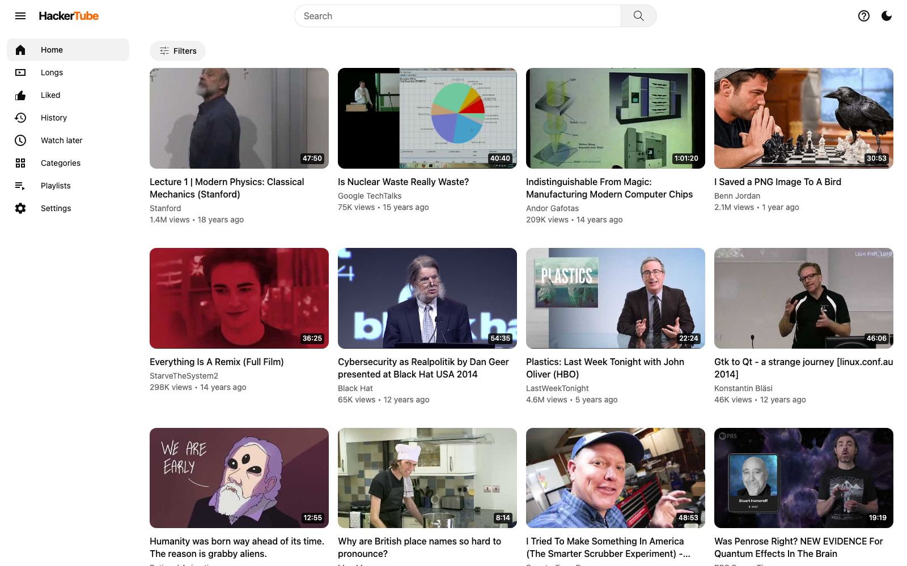

10 月底的一個週五晚上 11 點，Karpathy 累了，打開 YouTube 想隨便看點東西。首頁是一整面誇張的縮圖和老掉牙的題目，內容像電影《蠢蛋進化論》裡演的，他直接叫它「enshittified wall of slop」。他說這套演算法大概很適合網路上的中位數使用者，**只是不適合他**。

隔天早上，他請 Opus 5.5 做一個 YouTube clone，影片只收 Hacker News 上有人推薦過的。Opus 把 HN 留言全部抓下來，濾掉垃圾訊息，留下 4 萬則推薦影片的留言，對應到 6,454 支影片、150 個主題，時間從 2007 年到 2026 年。連同介面、網域和部署，總共約 2 小時。

兩小時做出網站不是重點，重點是他不再讓 YouTube 決定他看什麼。**現在大量內容都被演算法控制，所以收集資訊的管道必須更多元，再請 AI 來排序。我認為這是 AI 最重要的用法之一。**

## 他親手做的只有三件事

Karpathy 在附註裡說，他用 Claude Code 桌面版、Opus 5.5 的 Medium effort 當預設，現在只跟 Claude 講話。真正的手動工作只有三件：

1. 去 Google Cloud UI 生一組 API key，用來查 YouTube 影片的中繼資料
2. 開一台 VPS
3. 買網域

之後他把 IP 丟給 Claude，叫它部署、加固、最佳化。這三件都和帳號、機器、付款有關，其餘的抓取、篩選、分類、寫介面都交給了 Claude。

**HackerTube 的功能裡，有兩項最值得看**：一是不用上傳者挑的縮圖，改用影片 50% 處的畫面；二是站台資料可以整包匯出給你的 agent，資料頁 hackertube.org/data 列出 videos.jsonl、mentions.jsonl、taxonomy.json。整條排序管線，從「哪些留言算數」到「最後怎麼排」，都可以被拿走、改寫。

## 2 月他先做的是 RSS

台灣時間 2 月 2 日，他發文說自己最近更常回去用 RSS／Atom 訂閱，品質好的長文多得多，為了挑釁而生的浮濫內容也少很多。貼文裡他寫：

> Any product that happens to look a bit different today but that has fundamentally the same incentive structures will eventually converge to the same black hole at the center of gravity well.

任何看起來不一樣、但底層誘因結構相同的產品，最後都會掉進同一個重力井中央的黑洞。接著他叫大家把 RSS 帶回來，或直接 vibe code 一個閱讀器，還附上 92 個 2025 年 HN 熱門部落格的 feed 清單。同一天有人問他 Substack，他回「another walled garden」。

HackerTube 可以看成這句話的推論。既然換個長相的產品最後都一樣，解法就得動誘因結構：來源換成 HN 上的人推薦過的影片，狀態存在自己的瀏覽器，也不用帳號。

這個判準也能拿來看任何產品：它的誘因是把人留住，還是幫你找到東西？

## 被演算法控制的證據

Karpathy 說首頁不適合他，這是主觀感受。但演算法會影響人，已經有實驗證據。

今年 2 月 18 日，Nature 刊出 〈The political effects of X's feed algorithm〉。研究團隊在 2023 年夏天做了七週的實地實驗：把活躍的美國 X 用戶隨機分派成「追蹤」（時間序）和「For You」（演算法）兩種時間軸，與 X 沒有合作，也不用平台內部數據。

**把演算法「打開」有效果，把演算法「關掉」沒有同等效果。**

被切到演算法的人，政策優先順序、對川普相關調查的看法、對烏克蘭戰爭的態度，整體指標往保守方向移動 0.12 個標準差；被切回時間序的人，這些態度幾乎沒動。這跟 2020 年美國大選期間 Meta 合作的實驗對得上：臉書、IG 的時間軸換成時間序，政治態度測不出效果。Nature 的解釋是，一開始被餵過的人，效果會留下來。

機制也支持這點：演算法會推保守內容、壓傳統媒體（新聞機構的貼文少 58.1%），被推的人開始追蹤保守政治行動者的帳號，關掉之後還繼續追。效果主要出現在共和黨與獨立選民身上；兩邊都不影響感情極化與黨派認同。

範圍要講清楚：這是 2023 年、X、美國用戶、政治態度，不能外推到所有平台，也不代表「看 YouTube 會把你變怎樣」。

內容這一端也有數據。Kapwing 2025 年 11 月的報告用新帳號記錄刷到的前 500 支 YouTube Shorts：**104 支（21%）是 AI 生成，165 支（33%）是 brainrot**，資料到 2025 年 10 月。這是一個新帳號的樣本，不是整個 YouTube 的統計，但它量的是新帳號一開始會看到什麼。

10 月 30 日，Wharton 教授 Ethan Mollick 說他每則貼文底下都有幾十則明顯的 AI 浮濫回覆；更糟的是，真人回覆（他舉的例子是 Anthropic 的人來回應他的問題）不會被回覆演算法優先顯示。

## 我的管道順序

我目前已經不太用 YouTube 來看東西了，X 才是第一優先。順序大概是這樣：

| 順序 | 管道 | 我的用法 | 為什麼 |
|---|---|---|---|
| 第一優先 | X | 主要獲取管道 | 演算法目前還算 OK；用 Grok 幫忙搜尋；API 比較親民 |
| 另外 | 抖音 | 大量 AI 新聞 | 很棒的管道 |
| 第二 | YouTube | 不當主要管道，更多是一種呈現方式 | 還是會看，Podcast 值得聽、值得看 |
| 第三 | Facebook、LinkedIn、IG | 還是可用 | 不當主要的獲取管道 |

X 放第一有一個現實理由：它的 API 是 pay-per-use，沒有訂閱制，Posts: Read 一筆 $0.005，同一則貼文在同一個 UTC 日內重複讀取不算第二次錢。每天盯幾十個帳號的小工具，成本算得出來。

Grok 讓我搜尋方便很多。Brian Roemmele 用 Grok Tasks 做每天早上的 X 摘要，形容成「取代噪音時間軸與無止盡手動滑動」：從「平台餵你」變成「你去要」。

## 別人怎麼換掉演算法

做法可以分成三層：自己訂閱來源、自建聚合器、委託 AI 寫稿的管線。

向陽喬木的 Obsidian RSS 插件，9 月更新時一次加了 600 個資訊源。卡爾的 AI 沃茨重做了一版資訊工作流，他的觀察是，AI 從全網找回來的前 10%，跟平台給你的資訊流高度重複。swyx 把 Opus 5.5 跑出來的 AINews 跟 6 Sol 並排比較，差距「night and day」，之後 Opus 5.5 成了預設。

**第二層的規則你改得到，第三層的標準你通常看不到。**

## AI 排序，也是一種排序

X 也是演算法，Nature 那篇講的就是 X。所以「目前還算 OK」只代表目前，不代表中立。Nikita Bier 今年 7 月、時任 X 產品負責人時說過，custom timeline 上的停留時間與互動，會塑造你的 For You。X 開源的 For You 程式碼是用 transformer 排序；Bier 說的 Grok 排序與標註，指的是 AI custom timeline，這是兩件事。

HackerTube 也有偏見，它把排序權交給 HN 的品味。發布當天就有人說「it all so bad」；也有人回，最新的影片是五個月前、「closer to a time capsule」。

再往下，品味到底是人的還是模型的？圈內人自己也吵。Chamath 說判斷與品味仍是人類獨有的領域；Andreessen 說頂尖模型在長期規劃、點子生成和品味上都「quite good」；Mollick 說在 agent 時代還講 AI 沒有品味是「obviously false」，但也承認他比較能接受對「AI 選擇的品質或多樣性」的質疑。Paul Graham 講的是創作端：人人都能做東西之後，差別在你選擇做什麼。

放回資訊攝取，品味的問題不會消失，只會換人扛。所以真正要問的是：**誰設定標準，你能不能改。** HackerTube 的資料可以整包匯出，這題它答得出來；平台首頁答不出來。

## 可以做的四件事

第一，把管道順序寫出來。哪一條負責什麼、你為什麼留著它，寫給自己看。

第二，把篩選標準寫清楚，再交給 AI。「找一些好的討論」不算標準，「本人第一手、附原始連結」才算。標準寫出來，之後才改得動。

第三，至少留一條不經演算法的來源。RSS、newsletter、一支固定的 Podcast 都可以。它不會更聰明，但它不會因為你這週多滑了兩分鐘就換內容。

第四，定期看 AI 漏了什麼。每週挑一次，自己手動搜尋對照。

**AI 最重要的用法之一，是幫我們快速找到對的東西，不被任何演算法挾持。** 但這要自己動手，不會因為換一個工具就自動發生。

## 延伸閱讀

- [Marc Andreessen 的四分法資訊攝取](https://ai-coding.wiselychen.com/andreessen-information-diet-ai-era-quarter-rule/)
- [Cognitive Surrender：AI 讓你想得變少](https://ai-coding.wiselychen.com/cognitive-surrender-ai-coding-comprehension-debt/)
- [Harness Engineering：Prompt 是建議，機制才是規則](https://ai-coding.wiselychen.com/agent-harness-three-migrations-mechanism/)

## 參考資料

- [Karpathy：HackerTube（頁面日期 01 Nov, 2026）](https://karpathy.bearblog.dev/hacker-tube/)
- [HackerTube 資料頁](https://hackertube.org/data)
- [Karpathy 的 RSS 貼文（2026-02-01 UTC，台北時間 2 月 2 日）](https://x.com/karpathy/status/2018043254986703167)
- [Karpathy 回覆 Substack](https://x.com/karpathy/status/2018048149903048980)
- [Gauthier et al., The political effects of X's feed algorithm, Nature 652, 416–423 (2026)](https://www.nature.com/articles/s41586-026-10098-2)
- [Guess et al., How do social media feed algorithms affect attitudes and behavior in an election campaign? Science (2023)](https://doi.org/10.1126/science.abp9364)
- [Kapwing：AI Slop Report（2025-11-28）](https://www.kapwing.com/blog/ai-slop-report-the-global-rise-of-low-quality-ai-videos/)
- [Ethan Mollick：回覆演算法不優先顯示真人回覆（2026-10-30）](https://x.com/emollick/status/2115983936195297639)
- [Ethan Mollick：反駁 AI 沒有判斷與品味](https://x.com/emollick/status/2085034843805528268)
- [X API 定價文件](https://docs.x.com/x-api/getting-started/pricing)
- [xai-org/x-algorithm](https://github.com/xai-org/x-algorithm)
- [Nikita Bier：custom timeline 的互動會塑造 For You](https://x.com/nikitabier/status/2078030057600381082)
- [Brian Roemmele：用 Grok Tasks 做每日 X 摘要](https://x.com/BrianRoemmele/status/2069050854884397558)
- [向陽喬木：RSS Obsidian 插件更新](https://x.com/vista8/status/2103124320713359507)
- [卡爾的 AI 沃茨：重做資訊工作流](https://x.com/aiwarts/status/2026665845225922750)
- [swyx：AINews 改用 Opus 5.5](https://x.com/swyx/status/2102650014552182920)
- [Paul Graham：AI 時代品味更重要](https://x.com/paulg/status/2022604692178522562)
- [Marc Andreessen：模型擅長長期規劃、點子與品味](https://x.com/pmarca/status/2048146270792142885)
- [Chamath：判斷與品味仍屬人類](https://x.com/chamath/status/2049497195376988615)
- [parsecranberry：對 HackerTube 的批評](https://x.com/parsecranberry/status/2116785470218924500)
- [Lincoln：最新影片是五個月前](https://x.com/Presidentlin/status/2116854338781856069)
