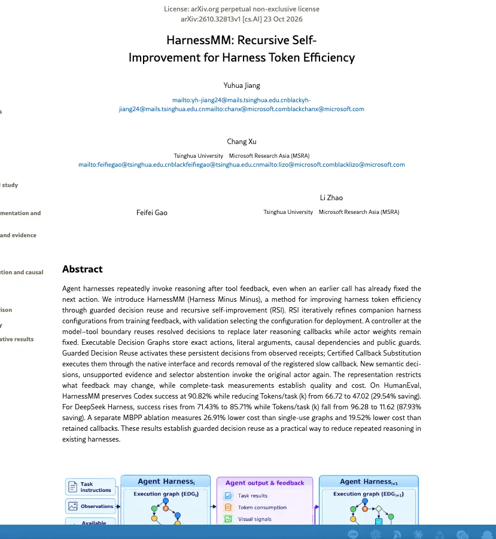
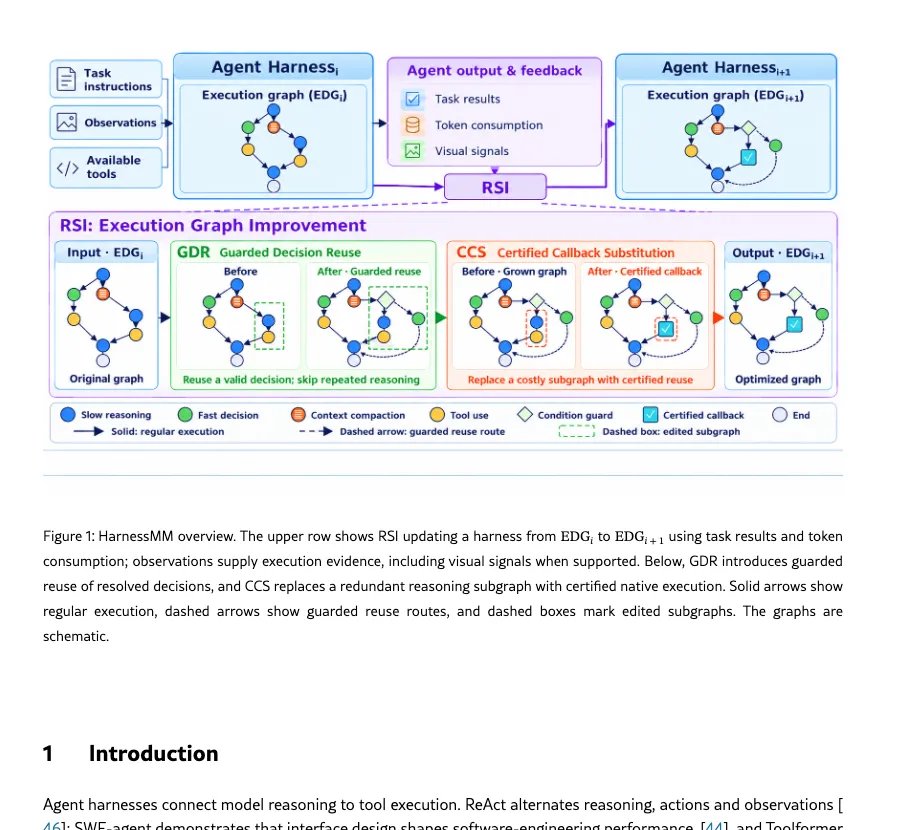

在日常開發流程裡，Agent 剛寫完檔案，下一步通常是編譯；若編譯回傳碼為 0，再下一步就是執行測試。這幾個動作與參數，其實在模型決定寫檔的那一刻就能定案。

然而，既有的 Agent Harness 普遍採用 ReAct 迴圈：只要工具回傳結果，即便只是個標準的 `returncode == 0` 或 `HTTP 200 OK`，控制器就會把整包幾萬 Token 的上下文歷史重新塞回模型，呼叫慢速推理問下一步。

清華大學與微軟亞洲研究院（MSRA）於 2026 年 10 月 23 日公開預印本〈[HarnessMM: Recursive Self-Improvement for Harness Token Efficiency](https://arxiv.org/abs/2610.32813)〉（arXiv:2610.32813v1，Yuhua Jiang 等人），針對這種「重新決定已決定的事」的算力浪費提出解法。

作者不修改底層模型權重，而是在模型與工具邊界插入控制器，讓已決定的步驟在符合守衛條件時直接派發執行。

社群在討論這篇論文時，最吸睛的標題往往是「快取已決定步驟，DeepSeek Harness 砍掉 87.93% Token，成功率從 71.43% 升至 85.71%（增加 14.28 個百分點）」。

但從企業 AI 架構師的視角來看，更值得深究的是：**這個架構的核心究竟是什麼？它本質上是哪種 Agent 設計模式的演進？以及那 87.93% 的節省背後，有哪些前提與限制？**

---

## 核心機制：把未來動作拆成 EDG（可執行決策圖）

論文首先切分了兩種不確定性：
- **語意不確定性（Semantic Uncertainty）**：決定寫什麼檔、改哪段程式碼、執行哪些命令。這需要大模型的慢速推理。
- **執行不確定性（Execution Uncertainty）**：指令已經寫死，未知的只是工具回傳碼會不會過。

當大模型在前一步已經固定了動作與具體參數，語意不確定性就已經消除；剩下的執行不確定性，本質上只需要等待工具回傳結果（Receipt）來啟動決策。**這件事用確定性的程式碼或守衛來接管就好，根本不需要大模型陪跑。**

為此，HarnessMM 設計了三大組件：

1. **可執行決策圖（Executable Decision Graph, EDG）**：大模型在進行慢速推理時，除了輸出當前的工具動作，還順手輸出一張有界無環圖（DAG）。每個節點綁定原生動作、完全寫死的字面參數（禁留變數）、前置依賴節點，以及公開守衛條件（$g_j$，如回傳碼為 0 或檔案存在）。
2. **守衛決策重用（Guarded Decision Reuse, GDR）**：工具傳回實際結果後，控制器直接對照 EDG 檢查前置是否完成、守衛是否為真。若只有單一合法節點，直接派發（0 個選擇器 Token）；若有多個候選分支，則關閉模型推理，僅吐出 1 個控制 Token 選取路徑。
3. **認證回呼替換（Certified Callback Substitution, CCS）**：符合條件就直接執行 native 動作，跳過大模型回呼並簽發稽核憑證。只有遇到非零錯誤碼、守衛未通過或需要全新語意推理時，才交回大模型重算。

---

## 本質是 Plan and Execute 的變種

仔細觀察 EDG 的架構，它本質上就是 **Plan and Execute（計畫與執行）** 模式的工程落地。

在傳統架構中：
- **ReAct**：一步一問，每動一次就向模型報告環境變化。在探索型任務中彈性最高，但在固定流水線上冗餘嚴重。
- **Plan and Execute**：一開始先由 Planner 輸出完整計畫清單，再交由 Executor 循序執行。缺點是一旦中途報錯，整張清單往往缺乏彈性反應能力。

HarnessMM 聰明的地方在於它把兩者融合：**在順境時，照著大模型 Plan 出來的 DAG 讓確定性程式碼一路跑（0 Token 消耗）；只有在逆境（守衛未過、報錯中斷）時，才退回 ReAct 模式重新推理。**

---

## 為什麼不直接用小模型做路由？

很多工程師會問：遇到這種輕量分支，在既有 Harness 裡串一顆 7B 或 8B 的小模型來做路由與決策，不也能達到省 Token 的效果？

這兩條路有本質上的區別：
- **大模型帶小模型（Speculative / Small Model Routing）**：小模型依然是神經網路，依然要接收整包上下文歷史、重新計算注意力矩陣，且依然存在幻覺與非預期輸出的機率。它只是降低了單次呼叫的 Token 單價。
- **EDG + 程式碼守衛**：它是完全確定性的工程邏輯。不需要傳輸 Context、零 Token 消耗、執行延遲在毫秒級，而且「絕對忠實」。

在程式碼開發與 CI/CD 的某些固定場景下，**確定性的程式碼永遠比任何神經網路更便宜、更可靠。**

---

## 算清 EDG 的邊界：替換悖論與適用場景

加一層控制器不是穩賺不賠的靈丹。論文自己點出一個計帳陷阱——**「替換悖論」（Substitution Paradox）**：

> 這就像為了解決每天 50 元的短程交通，特地花幾十萬元買車、繳車位租金與保養費。唯有當出車頻率夠高、行駛里程夠長，這筆固定投資才攤得平。
> 
> 放在 Agent 身上也是一樣：**唯有被省下的慢速推理，真正大於「預先寫圖、節點選擇、失敗重試」的總開銷，替換才真正划算。**

這也是為什麼論文中的 87.93% 必須拆開看：

1. **省下的幾乎全是輸入重播**：在 HumanEval 上，每題 Token 從 96.28k 降至 11.62k，其中有 85.35k 是少送了歷史 Context；模型輸出的 Token 反而略增了 0.70k（因為大模型需要額外花 Token 預畫 EDG）。
2. **基準線高時，省幅立刻收斂**：若換成原版每題本來就只花 11.62k 的 MiMo-v2.6-pro，節省率立刻縮水至 62.12%。估計這些模型內部早已有類似的分支快取或推測執行機制。
3. **在動態推導任務上會被反噬**：在 560 題 AIME 數學題上，每一步都需要隨機應變，根本無法預畫 DAG。結果 HarnessMM（5.90k）反而比原版（4.59k）**貴了 28.34%**。

此外，官方開源庫 [YuhuaJiang2002/HarnessMM](https://github.com/YuhuaJiang2002/HarnessMM) 內附的 `REPRODUCIBILITY.md` 明確註明測試使用的是合成資料，無法直接重現論文中的 Benchmark 分數。這代表工程團隊不能盲目套用數字，必須在自家工作流中驗證。

---

## 什麼場景才吃得到這個紅利？

這篇論文真正給企業架構師的落地啟示是：

* **高度適合**：「主幹高度機械化 + 局部保留彈性」的任務。例如 CI/CD 流水線檢驗、標準資料 ETL、寫檔後的編譯與測試循環。在這些場景中，80% 的動作是完全固定的，只有 20% 遇到 Exception 時才需要大模型介入。
* **完全不適合**：高度動態、邊界不固定的任務。例如探索型研究、複雜數學符號推導、尚未定義清楚的系統架構發想。在這些場景下，每一步都要根據最新線索隨機應變，預先畫圖只會增加負擔，老老實實跑 ReAct 才是最划算的選擇。

---

## Agent 進入下半場：從 Prompt 走向 Day 2 工程編排

Plan and Execute 這種模式，我幾乎在今年初時就已經開始在架構中實作。然而在過去這段時間，因為模型底座能力爆發，大部分團隊光是靠最基本的 ReAct 一步一問，就已經能跑出很不錯的 Demo 與初期成效。

沒想到一直到了年底，學界與工業界才開始將這種機制正式沉澱到 Agent 的底層 Harness 架構中。

這其實反映了一個趨勢：**底座模型的單點突破期正在放緩，Agent 正式進入下半場。** 

未來企業 AI 的競爭力，不再只是誰的模型比較會寫程式，而是誰能在 **Day 2 的 Agent 編排架構、安全護欄、Token 成本控制、以及確定性程式碼與模型推理的混搭效率** 上，做得更紮實、更可控。

---

## 坦白說

- 我還沒有在生產環境跑過 HarnessMM 官方的完整 pipeline。這篇分析基於 arXiv 論文公開資料與 GitHub 原始碼架構分析，不是生產線上的 Benchmark 重測。
- 官方開源庫裡的資料是合成資料，官方文件自己載明無法重現論文分數；87.93% 的極端省幅有特定的評測環境依賴，不能直接等同於你手頭專案的節省幅度。
- HumanEval 和 MBPP 都是短程單函式 coding 題目，大型專案中檔案相依與動態變動更多，預寫圖的失效重試比率必然會比論文測試集更高。

---

## 常見問題 Q&A

**Q: 什麼是 HarnessMM 的可執行決策圖（Executable Decision Graph, EDG）？**

EDG 是模型在慢速推理時順手輸出的一張有界無環圖（DAG）。每個節點寫死原生工具指令、具體參數（禁用變數）與公開守衛條件（如 CommandLine 回傳 0 或 API 回傳 200）。當後續工具回傳符合守衛條件時，控制器直接沿著 DAG 派發下一步動作，跳過大模型回呼，達成 0 Token 消耗。

**Q: 為什麼說 HarnessMM 本質上是 Plan and Execute 的變種？**

傳統 ReAct 是「每動一步就向模型重送整包上下文」，在固定流水線上造成大量輸入 Token 浪費；純 Plan and Execute 則是預先規劃整條路徑，但在遇到錯誤時缺乏隨機應變能力。HarnessMM 的 EDG 機制結合了兩者：順境時照著 Plan 好的 DAG 讓確定性程式碼跑反射，逆境（守衛未過、報錯）時才退回 ReAct 重新思考。

**Q: 為什麼不能直接用 7B 或 8B 的小模型來取代 EDG 守衛？**

小模型依然是神經網路（Neural Network），每次決策依然要傳輸歷史上下文並計算注意力機制，且仍有幻覺與格式跑版的機率；EDG 搭配程式碼守衛則是完全確定性的工程邏輯，零 Token 消耗、零推理延遲，而且「絕對忠實」。在流程已經確定的場景下，確定性的程式碼永遠比任何神經網路更便宜、更可靠。

**Q: 什麼樣的任務適合導入 HarnessMM，什麼場景反而會虧錢？**

它最適合「主幹高度機械化 + 局部保留彈性」的任務（如 CI/CD 流水線檢驗、固定資料清洗、寫檔後的編譯與測試循環）。在這些場景中，80% 的動作是固定的，只有 20% 異常需要大模型介入。但在高度動態推導、邊界不固定的任務（如 AIME 數學題、探索型架構設計），每一步都要隨機應變，預先畫圖的成本無法攤平，反而會觸發「替換悖論」（Substitution Paradox），在 AIME 題目上成本反而增加 28.34%。

---

## 延伸閱讀

- [Meta 把 Agent 的「決策」和「做事」拆開：同一顆 GPT-5.5，ProgramBench 從 63.7% 拉到 71.5%，但原本的 Agent 只用了 18% 預算就收工](https://ai-coding.wiselychen.com/meta-reasoning-controller-worker-separation/)
- [Pi 99.93% Cache Hit：10 億 token 只花 $2.65，Agent 選型要多盯一個數字](https://ai-coding.wiselychen.com/pi-cache-hit-99-93-context-compression-roadmap/)
- [Jev 的原理是讓大模型不寫字、直接讀 logit：開源 Laya 零樣本輸它，180 筆 RCA 合成資料微調後 0.496 變 0.921](https://ai-coding.wiselychen.com/jev-principle-logit-readout-laya-finetune-open-source/)

## 參考資料

- Yuhua Jiang、Chang Xu、Feifei Gao、Li Zhao（清華大學、微軟亞洲研究院），[HarnessMM: Recursive Self-Improvement for Harness Token Efficiency（arXiv:2610.32813v1）](https://arxiv.org/abs/2610.32813)，2026-10-23
- Yuhua Jiang，[YuhuaJiang2002/HarnessMM GitHub 儲存庫](https://github.com/YuhuaJiang2002/HarnessMM)，2026-10-26
- Yuhua Jiang，[HarnessMM Reproduction and Deployment 說明文件（REPRODUCIBILITY.md）](https://github.com/YuhuaJiang2002/HarnessMM/blob/main/docs/REPRODUCIBILITY.md)，2026-10-26
- DeepSeek，[deepseek-ai/deepseek-harness（Official dsh-v0.2.0-rc.1）](https://github.com/deepseek-ai/deepseek-harness/commit/4878cdabd87d4041bdaff61d04c966883b9fd07a)，2026-09-30
- OpenAI，[openai/codex（Official CLI 0.142.5）](https://github.com/openai/codex/commit/26de83050b20f7e0ee211b9739e52ae00ce8032a)，2026-09-30
