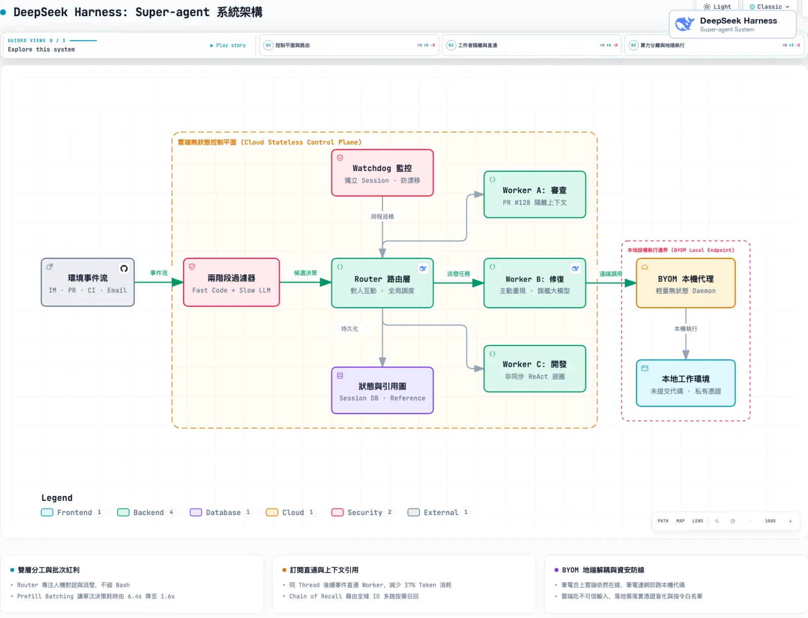

過去一年，幾乎所有軟體工程團隊都在嘗試 Coding Agent。從終端機 CLI 工具、VS Code 外掛到接入 MCP（Model Context Protocol）的各類自動化工作流，模型寫 Code、跑測試、改 Bug 的能力確實大幅提升。但當你試圖把 Agent 從「個人的結對程式設計助手」推進到「全團隊的自主協作者」時，所有架構師都會撞上同一堵高牆：

**現在的 Agent，本質上全被死死綁在「單一對話框（Single Session）」裡。**

2026 年 11 月 1 日，DeepSeek Harness 團隊（由喬羽嘉等人主導）公開發表了一篇極具啟發性的架構設計論文與原型：〈[Exploring Super-agent Design: Towards a More Autonomous Agent System](https://x.com/DeepSeekHarness)〉，並同步開源了驗證原型 [dsh-superagent-prototype](https://github.com/deepseek-ai/dsh-superagent-prototype)。

這不是產品功能宣傳，而是一篇「把分散式系統經典設計搬進 Agent 架構」的工程實踐。作者群一針見血地指出：**單一任務的瓶頸在於模型智能，但多任務並發的瓶頸，卻卡在人類的注意力極限。**

當工程師同時開 3 到 5 個終端機或聊天視窗時，大腦就已經超載。你得手動切換視窗、人肉同步 Context，而長耗時的編譯或測試還會把前台對話徹底卡死；一旦下班把筆電螢幕蓋上，所有跑一半的任務立即中斷。

DeepSeek Harness 提出的「Super-agent」概念，試圖徹底打破「一個任務開一個 Session」的限制，將 Agent 升級為一個**全天候在線、跨管道連續交互、具備高並發產能且能主動監聽修 Bug 的系統實體**。

這套架構到底怎麼運作？裡面的實驗數據有哪些玄機？身為看過無數企業系統現場的 AI 架構師，我們又該如何看待它背後帶來的 Token 帳單與資安隱患？

---

## 核心畫像：Super-agent 的四大特質與架構總覽

在 DeepSeek 的定義中，傳統 Agent 只是「等著你敲指令的命令式工具」，而 Super-agent 必須具備四個關鍵系統屬性：

1. **Continuous（連續性）**：無論使用者在 Slack/釘釘群聊、GitHub PR 評論還是 Email 裡互動，面對的都是同一個具備全局記憶的 Agent。你不用去猜「這件事我上次在 Session A 還是 Session B 說過」。
2. **Productive（高並發產能）**：前端對話絕不被後台長耗時任務阻塞，可以在前一個指令還在編譯測試時，立即接收並處理下一項任務。
3. **Proactive（主動事件驅動）**：不依賴人類手動打 Prompt 或 @bot。它像真實同事一樣監聽系統環境事件（Triggers），在群聊有人抱怨 Bug 時，默默在後台重現問題並開出修復 PR。
4. **Persistent（常駐在線與自癒）**：計算迴圈在雲端常駐，與本地設備解耦；即使個人電腦斷線或休眠，雲端核心依然能自動調度並具備外部監控自我修復能力。

這四個特質不可能只靠改寫 System Prompt 或套一個 ReAct 迴圈達成，必須仰賴扎實的系統工程分層。論文給出的五大核心模組，幾乎每一項都借鑒了經典作業系統與分散式架構的思想：

*圖：DeepSeek Harness Super-agent 架構總覽——雙層路由、事件直通、上下文引用圖與 BYOM 算力環境分離（以 Archify 繪製）*

---

## 模組解構一：雙層架構（Two-Level Architecture）——吞吐與連續性的完美解耦

在多任務場景下，傳統架構陷入了兩難：
- **全部事件塞進同一個 Session**：全局上下文最完整，但 ReAct 迴圈是同步單線程運作，任務吞吐量極低，而且不同任務的中間輸出交織在一起，會嚴重污染 Context Window。
- **每個任務開獨立 Session**：並發吞吐量拉滿，但彼此完全隔離，跨任務缺乏全局視野，多個 Session 同時在群聊裡回話會引發災難級的混亂。

DeepSeek Harness 借鑒了控制面（Control Plane）與資料面（Data Plane）的分離思想，設計了**雙層架構**：

### 1. 路由層（Router Layer）：輕量大腦與 Prefill 批次魔法
- **職責**：長壽命（Long-lived）節點，統一承接所有管道的人機交互，掌握全局狀態與記憶，負責任務派發與協調。
- **關鍵設計**：**Router 絕不親自下場跑 Code 或執行工具**（它甚至不需要配備 Bash Tool）。因為不處理重推理與複雜工具鏈，Router 可以採用反應極快、成本低廉的小模型。
- **批次處理（Prefill Batching）**：很多人擔心單一 Router 會成為系統瓶頸。但論文的壓力測試揭露了一個大模型推論的底層特性：當外部事件突發湧入時，等待隊列中的 Triggers 會在下一輪被自動合併成一個 API Request。因為輸入長、輸出短，這些事件在 Prefill 階段高度並行計算。
  - **實測數據**：當 Trigger 到達率從每分鐘 1 個暴增到 40 個時，平均 Batch Size 從 1.0 升至 2.8，單次請求耗時僅從 2.5 秒微幅升至 3.9 秒，**換算下來每個決策的攤提推理耗時（Amortized Time per Decision）反而從 6.4 秒大幅驟降到 1.6 秒！** 這意味著在一般團隊規模下，單一 Router 根本不會塞車。

### 2. 工作者層（Worker Layer）：上下文隔離的重裝執行軍
- **職責**：每個 Worker 是一個獨立隔離的 Session，配備全套工具鏈（Bash、代碼編輯、測試環境）與最強大的旗艦推理模型，專注執行單一任務。
- **邊界控制**：**Worker 永遠不直接與人類對話**。它們所有繁雜的中間推理思考、工具報錯都不會直接丟給外部頻道，而是將結果精簡摘要回報給 Router，再由 Router 統一代發，徹底杜絕了多 Agent 在聊天室洗版的亂象。

---

## 模組解構二：事件驅動與兩階段過濾（Event-Driven & Pass-Through）

要讓 Agent 具備主動性，系統輸入必須從「人類手打 Prompt」轉變為「半結構化環境事件流（Triggers）」，包括聊天訊息、PR Review 留言、CI 構建失敗紀錄、Calendar 提醒等。

但企業群聊裡的垃圾訊息遠多於正經需求，如果每條訊息都呼叫一次大模型，系統不是被慢死就是破產。DeepSeek 採用了經典系統的 **Fast Path / Slow Path** 模式：

1. **第一階段：程式碼規則過濾（Fast Path）**
   - 透過確定性的硬邏輯（來源群組檢查、Bot 白名單、發言者權限）進行第一道過濾。絕大部分閒聊與無關訊息在呼叫 LLM 之前就直接被 Drop 掉。
2. **第二階段：語意策略決策（Slow Path）**
   - 通過 Fast Path 的候選事件才交由模型，依據 Prompt 定義的業務策略（例如：「若有人反饋特定模組報錯，嘗試介入重現」）判斷是否需要採取行動。
3. **訂閱與直通機制（Subscription & Pass-through）**
   - 當 Router 為某個 PR 或 Discussion Thread 建立了負責的 Worker 後，該 Worker 會直接訂閱這個 Thread。
   - 後續發生在該 Thread 裡的追問或 CI 訊息，**程式碼層面直接走 Fast Path 繞過 Router 直通 Worker**。
   - 這一設計至關重要：它讓 Router 擺脫了重複轉發的泥潭。消融實驗顯示，**拿掉直通機制後，雖然完成時間差不多，但 Router 的決策次數暴增了 30%，整體 Cache-read Token 更是直接激增了 37%（從 23.2M 飆升至 31.8M）**。

---

## 模組解構三：上下文快取化與引用鏈（Inline, Spill & Chain of Recall）

在長生命週期的多任務系統中，「上下文窗口（Context Window）就是系統快取」。無腦塞入所有資訊會稀釋模型注意力，但塞得太少又會導致頻繁的工具呼叫。

DeepSeek 借鑒了編譯器與虛擬記憶體技術，提出了 **Inline & Spill** 原則：
- **Inline（局部性置入）**：模型當前極可能需要的局部資訊直接放在上下文（例如當前訊息前 50 字、前後相鄰兩則對話、相關物件的全局 ID）。
- **Spill（外部溢出）**：長篇內容或非即時資訊截斷丟在外部儲存，只在上下文留下引用指標（Pointer）。

更精妙的是長壽命 Router 面對歷史資訊的解決方案：**Chain of Recall（引用鏈跳轉）**。
Router 不可能將過去幾週的任務歷史全塞在 Context 裡。系統給每個 Trigger、Thread 與 Worker 唯一的全局 ID，構建出一張參考圖譜（Reference Graph）。當使用者在群聊裡突然提起：「上次在 PR #128 討論的字體問題處理得怎樣了？」Router 能順著 ID 像走指針一樣：

$$\text{當前訊息} \xrightarrow{\text{hop 1}} \text{Thread \#08} \xrightarrow{\text{hop 2}} \text{Worker \#03} \xrightarrow{\text{hop 3}} \text{PR \#128 評論與進度}$$

這種按需多跳（Hop-by-hop）召回機制，兼顧了全域記憶與 Context 精簡度。

---

## 模組解構四：全雙工異步迴圈與跨管道適配

傳統 ReAct loop 是同步阻塞的（Half-Duplex）：當 Agent 呼叫 `run_tests()`，整個迴圈停擺，直到幾分鐘後測試跑完回傳結果，這期間使用者輸入任何訊息都無法回應。

DeepSeek Harness 將指令拆解為非同步的 `start()` 與 `stop()`：
- 呼叫 `start()` 後，底層立即返回 `Started` 通知，ReAct 迴圈不卡死，秒回使用者「已啟動背景測試」，並隨時接受新插隊的指示；
- 幾分鐘後測試在背景完成，以一個「新事件」的方式發回給 Session 觸發下一步推理。

而在人機介面端，Super-agent 落實了嚴格的管道分級策略：
- **即時通訊群聊（Slack / 釘釘）**：遵循「**不超過 100 字**」的硬性規則，只說結論、只問關鍵決策，絕不發出冗長除錯日誌干擾團隊。
- **異步工作平台（GitHub PR / Email）**：輸出高密度、結構化的技術脈絡，包含復現步驟、架構更動說明與測試證據。

---

## 模組解構五：算力、狀態與環境三分離，以及 BYOM 的現場智慧

這是最能看出 DeepSeek Harness 團隊具備「第一線工程實戰經驗」的設計。

傳統做法將三樣東西死死綁在一台機器上：**運行 Agent Loop 的算力**、**對話狀態**、以及**程式碼與執行環境**。

Anthropic 在其發布的 Managed Agents（Decoupling the brain from the hands）概念中，提倡將腦（Agent Loop）與手（環境）分離，但其手主要仰賴雲端動態拉起虛擬沙箱（Sandbox）。

然而，**真實企業研發的痛點在於：沙箱根本無法完美複製工程師的日常環境！**
工程師本機上有沒 commit 的暫存代碼、本機私有設定檔、連通公司內網特定資料庫的 VPN、甚至特殊的硬體加速器。

DeepSeek 採用了兩層解耦：
1. **算力與狀態解耦**：雲端無狀態容器跑 Agent Loop，持久化狀態交給外部資料庫。筆電合上、本地斷線，雲端的大腦依然活著。
2. **算力與環境解耦（BYOM: Bring Your Own Machine）**：Agent Loop 在雲端，但直接透過輕量級 Daemon 連線到工程師自己的工作電腦。Daemon 不維護任何 Session 狀態，只負責單純的指令執行與結果回傳。

當工程師合上筆電開會，雲端繼續監聽事件；當工程師重新掀開筆電連網，積累的本地測試與代碼修改任務自動在本地機器上跑完。

---

## 數據真相：消融實驗裡的「成本與效能交換」

這篇論文最誠實、也最值得架構師細讀的地方，在於其第 7 節的端到端消融實驗。

實驗以 300 則混合了閒聊、追問、取消與 CI 訊息的事件流（其中包含約 20 個真實工作需求）為負載，比較四種不同架構（模擬耗時工具，跑 5 次取平均）：

| 架構設計 | 任務完成時間 p50 (分) | 任務完成時間 p95 (分) | 總 Cache-Read Token 消耗 |
|---|---|---|---|
| **Super-agent (完整版)** | **12.4** | **15.7** | **23.2 M** |
| Super-agent (無 Pass-through 直通) | 12.6 | 15.5 | 31.8 M |
| 單 Session + 委派 Prompt（明確要求放手給 Subagent） | 13.8 | 29.0 | 10.8 M |
| 單 Session + 中立 Prompt（讓模型自行判斷是否委派） | 20.4 | 29.5 | 6.1 M |

*數據來源：DeepSeek Harness 〈Exploring Super-agent Design〉論文表 1*

### 架構師解讀這張表的兩個關鍵：

**第一，單 Session 的 Prompt 委派是不可靠的，唯有系統級架構能消除長尾。**
在中立 Prompt 下，單 Session 模型 5 次測試裡「全部決定自己把任務幹完」，導致頻繁被新訊息打斷，p95 耗時飆到 29.5 分鐘。即使加上強制委派 Prompt，模型依然會自作聰明判斷「這個任務很小我來就好」，5 次裡還是有 1 次自己做，留下了長達 29 分鐘的延遲長尾。Super-agent 透過雙層架構從系統層面剝奪 Router 的執行權，才徹底穩住了 15.7 分鐘的 p95。

**第二，天下沒有白吃的午餐：速度是用 2 到 4 倍的 Token 換來的。**
Super-agent 為了維持多 Session 隔離與上下文直通，單次測試消耗了 **23.2M Token**，是單 Session 委派模式（10.8M）的 **2.1 倍**，更是最原始單 Session（6.1M）的 **3.8 倍**！
這就是工程的客觀代價：**你用顯著膨脹的 Token 帳單，買到了接近翻倍的響應穩定性與多任務並發力。**

---

## 企業現場視角：光環背後的四大隱患與未解難題

站在企業 AI 架構師的角度，Super-agent 展示了一幅極具吸引力的未來圖景，但若要在明天把它推進生產環境，以下四個問題是論文坦承、而且企業必須嚴陣以待的「地雷」：

### 1. BYOM 的資安噩夢：Prompt Injection 與內網穿透
這是整套架構最大的安全破口。
- 雲端 Agent Loop 天天在公開群聊、PR 評論接收非受信輸入（Untrusted Input），這代表它極度容易受到間接 Prompt Injection 攻擊。
- 而在 BYOM 架構下，雲端 Agent Loop 與開發者本機的 Daemon 保持連線。**如果雲端 Agent 大腦被駭客注入惡意指令，連線到它上面的所有開發者本機，瞬間全變成駭客在企業內網的跳板！**
- 企業落地前，必須嚴格實現「憑證盲化（Credential Blindness）」——Agent 可以調用具有權限的介面，但模型本身的 Context Window 絕對不能看到平文密鑰；同時本地 Daemon 必須具備剛性的命令白名單機制。

### 2. 帳單衝擊：Token 膨脹與業務價值的算盤
正如消融數據所示，Token 消耗翻了 2 到 4 倍。如果一個 50 人的研發團隊全天候掛著 Super-agent，背後的 API 呼叫成本是否能被其產出的研發效率覆蓋？如果沒有搭配完善的 Prompt Caching、開源地端小模型做 Router，這筆開銷會迅速吃垮團隊的 AI 預算。

### 3. 長期記憶的失憶症
Chain of Recall 靠引用圖解決了數天至數週內的按需召回，但當系統運行數月、累積了數萬個 PR 與決策節點時，引用圖的深度與檢索精準度會急劇劣化。真正的全域長壽命記憶架構，目前在業界依然沒有標準答案。

### 4. 外部 Watchdog 的重要性
論文非常務實地引入了第 6 個模組——**Watchdog**。
在分散式 Agent 系統中，傳統的 Process 存活檢查（Heartbeat）毫無意義。Worker 沒崩潰，但模型可能陷入「反覆讀同一個檔案又刪除」的無效推理死循環，或是語意目標發生漂移（Goal Drift）。使用另一個獨立的 LLM 定期巡檢 Worker 的實質進展，是長期運作不可或缺的防護欄。

---

## 總結與架構師建議

DeepSeek Harness 的 Super-agent 探索，代表了 Agent 系統從「提示詞工程」邁向「分散式系統工程」的里程碑。它清楚地告訴我們：**解決多任務協同，不能寄望大模型在一夜之間變得全知全能，而要靠經典的架構約束——解耦、快取、批次化與控制面分離。**

對於正在規劃企業內部 Agent 基礎設施的架構師，我的三點落地建議：
1. **不要在單一 Session 裡靠 Prompt 賭模型的自律**：把路由（對人與分派）與執行（寫代碼與跑工具）拆成雙層，哪怕只是用極簡架構實作，也能立刻大幅消除任務延遲的長尾。
2. **算清楚並發帶來的 Token 帳單**：在享受 15 分鐘交付的同時，務必落實 Fast-Path 規則過濾與訂閱直通，避免無效 Context 掏空預算。
3. **在資安邊界確立前，對 BYOM 保持謹慎**：切勿將雲端不可信輸入與內部高權限開發機未加隔離地直通，在沙箱隔離與憑證盲化就緒前，優先採用受限的雲端專用環境。

未來的 AI 協作者絕不會是一個整天等你敲 Enter 的對話框。但要讓它安全、穩定、經濟地成為團隊的一員，系統工程師的苦工才剛剛開始。

---

## 參考資料與延伸閱讀

- DeepSeek Harness Team（Yujia Qiao et al.）, 〈[Exploring Super-agent Design: Towards a More Autonomous Agent System](https://x.com/DeepSeekHarness)〉（2026-11-01）
- DeepSeek AI 開源原型庫：[GitHub - deepseek-ai/dsh-superagent-prototype](https://github.com/deepseek-ai/dsh-superagent-prototype)
- Anthropic, 〈[Decoupling the brain from the hands: Managed agents](https://www.anthropic.com/research/managed-agents)〉（2025/2026）
- 清華大學與微軟亞洲研究院 HarnessMM 論文：〈[HarnessMM: Recursive Self-Improvement for Harness Token Efficiency](https://arxiv.org/abs/2610.32813)〉（arXiv:2610.32813）
