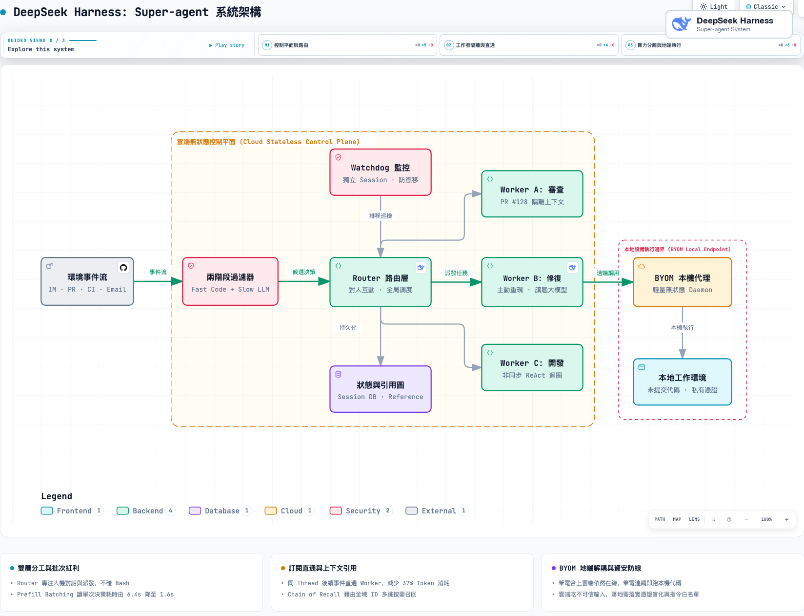

你的螢幕上同時開了 3 到 5 個 Agent 終端機或視窗：
一個在改登入 Bug、一個在寫 API、一個在跑寫投影片，一個在寫 Email。

你這裡做一點決策，另外一邊已經不知道跑去哪裡了；你已經忘了剛才把哪段 Code 貼給了哪一個視窗，長耗時的編譯還把前台對話死死卡住。更崩潰的是下班把筆電螢幕一蓋，所有跑一半的工作全部斷線歸零。

你以為是自己精力不夠？

其實不是。這正是 DeepSeek Harness 團隊在最新架構論文〈[Exploring Super-agent Design: Towards a More Autonomous Agent System](https://x.com/DeepSeekHarness)〉中，一針見血點破的最大死穴：

> **「單一任務的瓶頸在於模型智能，但多任務並發的瓶頸，卻卡在人類的注意力極限。」**

現在主流的 Agent（不論是 CLI、IDE 外掛還是 MCP），本質上全被死死綁在「單一對話框（Single Session）」裡。一個人只要同時追蹤 3 到 5 個 Session，大腦就注定超載。單任務再聰明，並發協同依然被人的注意力死死卡死。

為了解決這個瓶頸，DeepSeek 提出了「Super-agent」雙層架構，跳脫提示詞工程，把經典的分散式作業系統設計搬進了 Agent。

這可能是目前多 Agent 架構最優雅、甚至接近終極的解法之一。

---

## 架構剖析：Super-agent 的四大核心支柱

在傳統做法中，我們習慣把所有東西塞在同一個 Session，結果上下文嚴重污染、任務一長前台直接卡死；如果給每個任務開獨立 Session，多個 Agent 同時在群聊回話又會造成災難級混亂。

DeepSeek 的核心想法很純粹：**把「人機對話」與「底層執行」徹底解耦**。

*圖：DeepSeek Harness Super-agent 架構總覽——雙層路由、事件直通、上下文引用圖與 BYOM 算力環境分離（以 Archify 繪製）*

### 1. Router / Worker 雙層分工
- **Router 路由層（大腦）**：長壽命節點，負責統一在 Slack、GitHub、Email 承接人機互動與任務派發。**最關鍵的設計是：Router 絕不親自跑 Code，它甚至沒有安裝 Bash 工具**。因為只做輕量調度與記憶，它可以用反應快、成本低的小模型跑。
- **Worker 執行層（打工人）**：每個任務獨立開一個上下文隔離的 Session，配備全套工具鏈（Bash、編輯器、測試）與最強旗艦模型，專注幹活。**Worker 絕不直接對人說話**，執行完只將精簡結果回報給 Router 代發，徹底杜絕多 Agent 在群聊洗版。

### 2. 事件驅動與訂閱直通（Subscription & Pass-through）
系統的輸入不再是等你手敲 Prompt，而是監聽群聊、PR、CI 的環境事件（Triggers）：
- **兩階段過濾**：90% 的閒聊與無關訊息在呼叫 LLM 之前，就被確定性的程式碼規則直接過濾（Fast Path）；真正需要語意判斷的候選事件才交給模型（Slow Path）。
- **事件直通**：一旦 Worker 接手某個 PR，後續該 PR 的 CI 報錯或追問，**程式碼層面直接繞過 Router 直通 Worker**。消融實驗顯示，光是這個直通機制，就替 Router 減少了 30% 的決策負擔，省下 37% 的 Token 消耗（從 31.8M 降至 23.2M）。

### 3. 全雙工異步迴圈
傳統 ReAct 迴圈是同步阻塞的，跑個測試前台就凍結。DeepSeek 將長耗時工具改成非同步的 `start()` / `stop()`：
- 呼叫 `start()` 後，底層秒回「已在背景啟動」，前台對話不卡死，隨時可接收新指令；
- 測試完成後，結果以「新事件」發回 Session 觸發下一步推理。

### 4. 算力與環境分離（BYOM: Bring Your Own Machine）
這是最貼合工程現場的設計。傳統雲端沙箱根本無法複製工程師電腦裡的未 commit 代碼、私有設定檔與內網環境。
- Agent Loop 與會話狀態在雲端常駐（筆電蓋上雲端不滅）；
- 真正的代碼執行環境留在工程師筆電（BYOM），透過輕量 Daemon 遠端調用。筆電連網即自動接單跑本機代碼，代碼與憑證不離身。

---

## 數據與戰果：不是實驗室玩具

DeepSeek Harness 團隊把這套系統常駐在內部日常研發中，並在論文中展示了三個指標性成果：

1. **跨管道上下文無縫漫遊**：工程師在 IM 群聊交代「用方案 A」，稍後在 GitHub PR Review 改口說「改用方案 B」，Agent 能直接貫通兩邊的上下文脈絡，自動在 PR 裡更正代碼，無須人工手動搬運。
2. **無人 @ 也能主動修復 Bug（推測執行）**：使用者在公開群聊閒聊抱怨「點兩下會有雙擊 Bug」，**完全沒有任何人 @ 它**，Agent 監聽到事件後，自己在後台重現問題、抓出 Root Cause，並自動開出修復 PR 送審。
3. **自我反哺開發**：這套 Super-agent 目前每天都在參與 DeepSeek Harness 框架本身的日常代碼編寫與測試。

而在 300 則真實事件流的端到端壓力測試中：
- **任務完成時間（p95）砍半**：從單 Session 的 **29.5 分鐘** 直接壓縮到 **15.7 分鐘**（p50 達到 12.4 分鐘），徹底消滅了模型自作聰明「判斷任務很小我自己做」而導致的卡死長尾。
- **突發流量下的批次紅利**：當事件到達率從每分鐘 1 個暴增至 40 個時，大模型的 Prefill Batching 讓排隊事件合併推論，**單個決策的攤提耗時反而由 6.4 秒驟降至 1.6 秒**。

---

## 我的實際體感：跑了一個月 Multi-Agent 後撞到的兩堵牆

看完了 DeepSeek 的論文，我相信很多工程師會熱血沸騰。
但對我來說，這套觀念其實非常直覺。因為**我自己一個多月前就已經在跑類似的架構了**。

我的架構雖然沒有做 DeepSeek 那樣精細的兩層事件過濾，但我自己有一套跑在生產環境的 **Multi-Agent 體系（雲端核心 + 本地節點）**。正如我上個月在文章中所分享的，我以 Google Drive、Slack 與 GitHub 作為媒介，**同時間常駐跑 4 到 8 個 Agent Session**，這套系統我自己已經實打實跑了超過一個月。

親自下場撞過牆才會明白：**要讓這種「Humanless」自主架構真正跑順，最難的根本不是模型技術，而是兩個血淋淋的現場問題。**

### 護城河一：知識庫與工單系統的「保真度」，決定了你的注意力能不能被釋放

架構上想做到 Humanless（無人介入），前提是 Agent 必須有極其精準的 Context Grounding（真實脈絡錨定）。

在真實開發環境裡，如果工單（Ticket）的驗收標準寫得含糊、知識庫（架構文檔、測試規範、業務邏輯）充斥著過期資訊：
**Agent 在背景跑得越自主，你出 Bug 的速度就越快。**

問題是：**企業內部的知識庫，幾乎不可能「100% 值得相信」**。
別說大企業，就連我自己個人的工作流文檔，都很難做到 100% 保真。

結果是什麼？
Agent 做出的決策常常踩雷，改出來的代碼看似漂亮卻破壞了隱性業務規則，工程師到處都要跳進去救火、微調與手動介入。
最後繞了一大圈：**「人類注意力依然是最大的系統瓶頸」**。

要讓這種自主架構跑得動，前期往往需要花極長的時間進行文檔治理、知識庫清洗與工單規格標準化——這是一場極其痛苦、卻無法逃避的枯燥苦工。如果知識庫是一堆爛泥，給它再完美的 Super-agent 架構，產出的也只會是自動化垃圾。

### 護城河二：Dashboard 可視化，決定了你「敢不敢放手」的心理門檻

很多人以為導入自主 Agent 是一場技術挑戰，但我這個月最深的體會是：**這本質上是一場「信任問題」**。

這感覺非常像 Claude Code 剛推出時，你坐在螢幕前猶豫要不要按下 `--dangerously-skip-permissions` 的那一刻：
- 你不按，它每執行一個指令、每改一個檔案都要停下來問你 `(y/n)`，多任務並發效率極低；
- 你按下去，心裡又直發毛，不知道它等一下會不會在背景自作主張，把你的重要目錄或資料庫清掉。

當你後台同時常駐跑 8 個 Agent 時，如果沒有一個強大的 Dashboard，你的恐懼會被成倍放大。
你會陷入嚴重的焦慮：
*它現在到底改到哪了？*
*它卡在哪一步？*
*它為什麼突然決定重構這個模組？它做出這個破壞性更動的判斷依據是什麼？*

缺乏可觀測性（Observability），工程師就會因為恐懼而不斷在 8 個視窗之間來回切換去「盯梢看盤」——你的注意力再次被徹底綁架，多 Agent 的產能紅利瞬間歸零。

因此，要讓團隊有信心放手，最大的關鍵是**親手打造一個高透明度的 Dashboard**，清楚掌握：
1. **哪些 Agent 正在跑？各自所屬的任務邊界是什麼？**
2. **當前卡在哪個節點？是在等待外部 IO、編譯報錯、還是推理死循環？**
3. **它做這項決策的 Context 來源與 Confidence（信心度）是什麼？**

**唯有看得見邊界、進度與決策依據，工程師才有心理安全感真正把手放開。**

---

## 總結：Agent 落地走入下半場

Agent 可以做事情、可以寫程式，這件事在 2026 年已經不需要再被驗證了。
DeepSeek 的 Super-agent 論文，為我們指明了從「單 Session 玩具」走向「分散式多工協作者」的架構藍圖。

但這也標誌著 Agent 工程正式走入了殘酷的下半場。
未來的決戰點，**絕對不在於你接了多少個最新的旗艦大模型**，而在於你能不能跨過兩座重裝工程護城河：

1. **輸入端的護城河**：你有沒有足夠健全、高保真的知識庫與工單體系，去精準引導它？
2. **輸出端的護城河**：你有沒有足夠透明、可追溯的可觀測 Dashboard，讓工程師敢於放下戒心，真正把權限交出去？

雙層架構是骨架，而知識治理與可觀測性才是血肉。只有當這兩座護城河築好時，人類的注意力才算真正得到解放。

---

## 參考資料與延伸閱讀

- DeepSeek Harness Team（Yujia Qiao et al.）, 〈[Exploring Super-agent Design: Towards a More Autonomous Agent System](https://x.com/DeepSeekHarness)〉（2026-11-01）
- DeepSeek AI 開源原型庫：[GitHub - deepseek-ai/dsh-superagent-prototype](https://github.com/deepseek-ai/dsh-superagent-prototype)
- Anthropic, 〈[Decoupling the brain from the hands: Managed agents](https://www.anthropic.com/research/managed-agents)〉（2025/2026）
