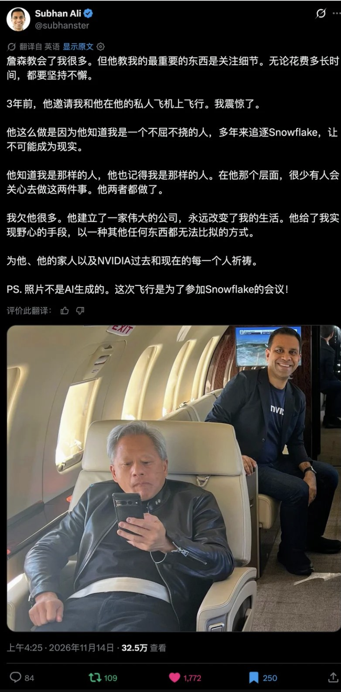

最近 X（Twitter）上關於黃仁勳（Jensen Huang）的討論鋪天蓋地。從[早前的 SPOF 討論與閃辭震盪](/jensen-huang-resigns-nvidia-spof-triggered/)、商業判斷的得失、Denny's 創業紀念碑的去留，到各種真假難辨的私生活八卦，幾乎佔據了所有科技圈的流量。

很多人習慣把黃仁勳拿來跟賈伯斯（Steve Jobs）或馬斯克（Elon Musk）相提並論，把他們歸類成同一種不食人間煙火的「矽谷超人」。但這幾天刷完 X 上大量自發湧現的真實故事後，我反而有一個完全不同的感覺：

**剝開千億帝國的光環，黃仁勳骨子裡其實就像我們身邊常見的那位 63 歲華人中年創業老闆。**

這張截圖就是最好的寫照：11 月 14 日，一位名叫 Subhan Ali（`@subhanster`）的輝達員工在 X 上發長文深情致敬黃仁勳，感謝老黃肯定他多年死磕 Snowflake 的韌性，甚至在三年前邀請他一起搭私人飛機去開會。結果因為配圖實在太「真實」，老黃在機艙裡低頭滑手機的神情被拍得一清二楚，平時瀟灑的皮衣大佬形象瞬間消失——果然，永遠不要相信那些公開發你「醜照」的朋友。但換個角度看，也正是這份毫無濾鏡的煙火氣，讓這段致敬顯得格外動人。

有賭性、有商業魄力，肯親自飛到第一線跟客戶、廠商吃飯喝酒搏感情，遇到旁邊的人有難也願意順手拉一把。他跟我們在台灣、在亞洲商界認識的那些中小企業老闆沒什麼兩樣，只是剛好押對了時代，錢多了一點、公司稍微大了那麼一點。

這批在 X 上流傳的故事，來源極度分散——時間線橫跨三十年，涵蓋學生志工、開源開發者、資深員工，乃至瀕臨破產的創業者，而且每個人的敘述細節都高度貼合他一貫的行事風格。這種規模與維度的交叉印證，很難用單一公關劇本來解釋。

看著這些零散卻充滿煙火氣的真實切片，腦海裡反覆浮現一句話：

> **「為人抱薪者，不可使其凍斃於風雪。」**

---

## 一、創業老闆的賭性與遠見：從 CUDA 到開源 AI 的兩次萬億級押注

很多人調侃黃仁勳愛穿黑皮夾克，說他在模仿賈伯斯；也有人笑他大熱天汗流浹背也不脫外套，沒新產品也要硬開一場發表會把老成績重講一遍。

但外行看的是舞台人設，內行看的是技術底氣與創業家敢賭身家的魄力。

2008 年為了向大眾科普並行計算，他直接拉來《流言終結者》（MythBusters），用 1,100 個噴嘴的彩彈槍一槍噴出《蒙娜麗莎》。會搞流量只是他的小技能，真正讓他與一般職業經理人拉開天壤之別的，是敢在**完全沒有人看好的時候梭哈未來**。

當年遊戲顯卡已經躺著領先全行業的時候，他敢把全部毛利押進根本沒人要的 CUDA，硬生生讓每張 GeForce 顯卡的成本直接漲了一半，短期內完全看不見回報。如果換成追求季度財報好看的職業 CEO，這種燒錢專案第一天就會被董事會砍掉。

而這幾年，當閉源大模型巨頭試圖築起高牆、壟斷算力話語權時，他悄然押下了另一個萬億級別的重注——**力挺開源 AI 生態**。

從重金戰略投資開源大本營 Hugging Face、深度整合模型部署與微調工具鏈，到力挺開源推理框架（如 vLLM、PyTorch 生態），甚至親自開源 Nemotron 系列模型與 NemoClaw 等開源 Agent 框架，他看得很透徹：

唯有讓開源 AI 從模型權重到 Agent 執行層全面百花齊放，全世界的開發者、中小企業與主權國家都能低門檻地訓練和部署自己的 Agent，算力的需求才會迎來真正的指數級爆發。

正是這種**「寧願承受短期陣痛、也要為十年後鋪路」**的硬核遠見，一次次築起了輝達今天的護城河。

---

## 二、商業與供應鏈打法：肯跟廠商吃飯喝酒的「江湖人情」

如果說技術遠見決定了輝達的上限，那老黃那套一點也不「高冷」的商業手法，則決定了它的下限與韌性。

矽谷有很多技術大牛，但極少有人能像黃仁勳一樣，把亞洲市場與亞洲供應鏈捏合得如此鐵板一塊。因為他的做生意之道，透著一股華人商界最熟悉、也最講究的「江湖打法」——**交朋友認準一個，就是長期打交道，人情世故永遠排在冷冰冰的合約前面。**

看一眼輝達的供應鏈版圖就知道了：台積電造晶片，韓國企業供記憶體，台灣廠商造伺服器。這些合作關係，全是老黃一家一家跑出來的，一頓一頓飯吃、一杯一杯酒敬、一年一年維護出來的交情。2024 年，他拉著台積電創辦人張忠謀、廣達創辦人林百里去台北夜市吃蚵仔煎；第二天又在「磚窯」家常菜館擺下一場供應鏈飯局，鴻海、廣達、和碩、華碩的大佬們悉數到場。

他把這種「江湖救急」的義氣，同樣延伸到了整個 AI 生態圈中：

- **清晨 6 點的救命電話**：2023 年聖誕節前，Serve Robotics 創辦人 Ali Kashani（`@ahkashani`）遭遇投資人臨時撤資，公司連薪水都發不出來，甚至已經在跟破產律師談了。絕望中他給老黃寫了封信。第二天早上 6 點，老黃的電話直接打了過來；當天晚上，老黃就親自帶著輝達團隊坐到他的餐桌旁商量對策。四個月後，這家公司成功敲響了那斯達克的鐘。
- **對微末聲音與開源開發者的零延遲響應**：11 年前，一名印度普通大學的學生（`@recurseparadox`）發 cold email 問能不能要幾塊 GPU 做研究，15 分鐘後就收到回信；開源專案 vLLM 的核心開發者 Simon Mo（`@simon_mo_`）回饋算力被收回、在 Blackwell 上的開發受阻，寫信給老黃，同一分鐘就收到回覆，問題連夜解決。

無論是像 Hugging Face 這樣的生態基石、推進開源 Agent 的社群，還是獨立的開源開發者，他從不居高臨下，而是真正把他們當成同一條船上的戰友。

---

## 三、珍惜人才與底層溫度：看不見的角落，最見人品

商業上的成功可以靠策略，但對「人」的尊重，卻只能源於骨子裡的教養。輝達員工 John Zedlewski（`@zstats`）分享過兩件事，很精準地詮釋了什麼是工程現場的領導力：

1. **工作上實事求是**：自動駕駛部門開會時，A 團隊抱怨 B 團隊的框架太慢。換作不懂技術的領導，往往只會打官腔說「我們研究一下，下週答覆你」，然後不了了之。但黃仁勳直接讓 B 團隊把整個資料流畫在白板上，標出每一次記憶體拷貝，多餘的開銷當場暴露並解決。原地分析、當場拍板，這種專業魅力讓工程師心服口服。
2. **絕境中雪中送炭**：當 John 重病住院、處於人生最低谷時，黃仁勳立刻動用自己的人脈聯繫史丹佛，幫他協調進入臨床試驗。

同樣的溫度，也發生在員工 Vartika Singh（`@vartuattheghat`）身上。她的妹妹在加州罹患腦癌且病情惡化，全家面臨天價醫療費與異國他鄉的絕望。黃仁勳依然抽出時間親自關心他們，幫這一家人渡過難關，甚至當面鼓勵她：「我為你感到驕傲。珍惜你們在一起的時光。」

他甚至把目光投向公司最容易被忽略的角落：

- 在輝達工作 11 年的 Gabriele Leone（`@ambertanuki`）回憶，疫情期間辦公室空空蕩蕩，廚房和清潔人員幾乎無活可幹。當許多大企業都在跟風裁員、美化財務報表時，黃仁勳決定把這些後勤人員全部留下，照常發薪。
- 早在 30 年前，學生志工 `@Fuzzygoat` 在洛杉磯 SIGGRAPH 的飯店電梯裡偶遇他，發現去會場的接駁車已經開走，老黃順手叫了輛計程車，堅持讓這個素不相識的學生一起坐。沒有投資，沒有利益交換，這份平等的善意讓那個學生記了整整三十年。

---

## 四、寫在最後：在 AI 浪潮下，我們該如何不被淘汰？

如今的商業世界充斥著太多精心設計的公關劇本，而在技術浪潮的另一端，我們每天都在焦慮 AI 即將取代多少工作、重構多少行業。

但透過這些無法輕易偽造的交叉證言，在冰冷的晶片與算力之外，我們看見的不是一尊高高在上的神像，而是一個有血有肉、有江湖氣也有人情味的 63 歲華人老闆。這，恰恰就是人類永遠無法被 AI 取代的底色。

如果把視角拉回我們自己身上，想要在這個 AI 時代站穩腳跟、不被淘汰，我們最該從他身上學走三件事：

### 1. 建立技術判斷力，也就是「Taste」

AI 很擅長在既有的框架裡算出最優解，但**只有人能決定方向在哪裡**。未來執行力會越來越便宜，真正稀缺的，是你能看穿技術本質、一眼辨別真偽與趨勢的品味與直覺——就像他在沒人看好時梭哈 CUDA 與開源生態一樣。

### 2. 守住人最重要的護城河——真實的人脈網絡

算力與演算法可以被複製，但一頓頓飯吃出來、一場場硬仗並肩打出來的信任不能。真正能幫你在關鍵時刻破局的，從來不是冷冰冰的合約或線上點讚，而是那個你隨時能打通電話、對方也願意為你兩肋插刀的真實關係網。

### 3. 你可以很 AI-Native，但永遠不要忘記「人的溫度」

這是最重要的一點。我們當然要擁抱最新技術，把各種 AI 工具與 Agent 用到極致；但千萬別把自己也活成了一台冷冰冰的演算法機器。不計短期得失的遠見、把人當成「人」而非數字的慈悲，以及在他人絕望時伸出援手的善意，才是碳基生命最動人的價值所在。
