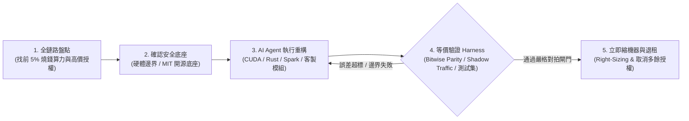

這兩天，一段關於「Claude 幫工程師榨乾 GPU 性能」的貼文在技術社群瘋傳：

> 有開發者讓 Claude 把 TRELLIS.2 從 PyTorch 改寫成 CUDA C++，整體速度提升 5.3 倍，H200 上相關測試另有 2.2 倍性能提升，AI 開發成本約 67 美元。

最後那句結論寫得很準：**「AI Coding 真正值錢的地方，不只是寫代碼，而是能把代碼跑得更快。」**

過去兩年，多數企業算 AI Coding 的 ROI（投資報酬率），算的都是「幫工程師少寫幾小時 CRUD、省下多少人力工時」。但在真實的企業財報裡，這種帳最難算——因為少寫兩小時程式不會立刻變成現金，反而常常因為 Vibe Coding 缺乏審查，製造出更多技術債與資安漏洞。

然而到了 2026 年，一條財務長（CFO）與基礎設施主管一聽就懂的硬核變現路線已經徹底跑通：**拿幾十到幾千美元的一次性 AI Agent Token 預算當槓桿，去啃下過去「資深人力太貴、工期太長、沒人敢自己造輪子」的硬骨頭**，直接砍掉企業每個月固定失血的四張帳單：

1. **GPU 推論算力帳單**（PyTorch 改寫純 CUDA C++）
2. **雲端 VM 運算帳單**（Python / Ruby 改寫 Rust）
3. **Big Data 叢集帳單**（Spark / Presto 診斷調優與轉譯）
4. **第三方商業 Library 與框架授權帳單**（用 AI 客製模組取代昂貴商業 SDK 與生態綁定）

在把這套模式搬進公司之前，我們先照慣例：**把四個戰場的原始案例、真實數據與翻車邊界全部查清楚。**

---

## 一、戰場一：AI 寫 CUDA C++ 榨乾 GPU——還原 TRELLIS.2「67 美元換 5.3 倍加速」的三個真相

先核對出處。這起案例並非都市傳說，原始作者是任職於 Hugging Face 的 3D 與電腦視覺機器學習工程師 **Suvaditya Mukherjee**（X 帳號 `@halcyonrayes`）。他在 2026 年 11 月 16 日開源了 [`suvadityamuk/trellis2-cuda`](https://github.com/suvadityamuk/trellis2-cuda)，在 Cursor 內驅動 **Claude Opus 5.5（medium）**，將微軟 40 億參數的 Image-to-3D 模型 **TRELLIS.2-4B** 端到端改寫成**零 Python 執行期（Zero Python Runtime）的純 CUDA C++**（約 3,100 行 C++/CUDA）。

但如果你直接去讀開源儲存庫裡的 `docs/blog.md` 工作紀錄與基準測試檔，會發現中文轉傳貼文漏掉了三個最關鍵的工程事實：

### 真相 1：「5.3 倍」與「2.2 倍」都在同一張 H200 上，差別是「精準度契約」
中文貼文寫成「整體提升 5.3 倍，H200 上另有 2.2 倍提升」，容易讓人誤以為是在不同硬體跑出來的兩組測試。事實上，**兩組數據都是在 Hugging Face Jobs 的同一規格 NVIDIA H200 上，連續跑完 5 張官方範例圖的端到端總耗時**（不含模型載入）：

| 執行版本 | 5 張圖總耗時（秒） | 相對官方 Eager 加速倍率 | 數值一致性標準 |
| :--- | :---: | :---: | :--- |
| 官方 PyTorch Eager | 566.5 秒 | 1.0×（基準） | 官方參考輸出 |
| 官方 `torch.compile` | 477.8 秒 | 1.19× | 編譯器浮點重排誤差範圍 |
| **`CUDA parity`（位元對齊版）** | **260.9 秒** | **2.2×** | **Bitwise Identical（位元級完全一致）** |
| **`CUDA fast`（`T2_FAST=1` 極速版）** | **106.6 秒** | **5.3×** | **Tolerance-bounded（誤差落在 `torch.compile` 同等區間內）** |

換句話說，如果你要求從輸入圖片、4 個 13 億參數的 Flow DiT、Sparse 3D VAE 到最終匯出紋理網格，每一步浮點運算順序、亂數種子甚至 PIL 縮放四捨五入都跟官方 PyTorch **一模一樣（Bitwise Parity）**，純 C++/CUDA 拿掉 Python 框架稅與動態調優開銷後，就已經直接快了 **2.2 倍**。而當你允許在官方 `torch.compile` 本身就能接受的微小幾何／色彩公差內換演算法時，速度直接暴衝到 **5.3 倍**——**單次任務佔用 H200 的時間直接減少 81.2%。**

### 真相 2：67 美元裡，Claude 只花了約 7 美元，剩下 60 多美元都在租 H200 跑驗證
很多人看到「AI 開發成本 67 美元」以為燒了 67 美元的 Token。根據作者公開帳單與儲存庫紀錄：
* **Claude 模型消耗**：僅約 **7 美元**。
* **Hugging Face Jobs 開發與測試算力**：合計約 **64 美元**（其中 H200 每小時 5 美元 × 8.4 小時開發與對齊測試佔 42 美元；排隊等待 H200 時開啟的 CPU 機器佔 17 美元；最後開全新容器從零重現位元對齊驗證 58 分鐘佔 5 美元）。

這筆投資回報有多誇張？一張雲端 H200 每小時租金 5 美元。**花了 7 美元買 AI 腦力、60 多美元買測試環境，換來推論管線省下超過八成的 GPU 秒數**——只要這個模型在線上累計跑超過 16 個小時，省下來的 H200 租金就把全部研發成本連本帶利賺回來了。

### 真相 3：真正拖慢 H200 的元兇根本不是 40 億參數模型，而是「餓死 GPU 的 CPU 後處理」
這份工作紀錄裡最值得架構師畫紅線的一句話是：

> **「令人意外的是，真正的瓶頸在 `to_glb` 匯出函式，而不是神經網路本身。把匯出搬上 GPU 帶來的收益比任何模型最佳化都大。」**

把 DiT 注意力機制升級成 Hopper 架構專屬的 **FlashAttention-3**，確實讓 Shape 與 Texture 模型推論分別從 `7.7s → 5.6s` 與 `3.7s → 2.6s`。但真正讓總時間雪崩式下降的，是 Agent 剖析完整條管線後，抓出了三個讓昂貴 H200 停下來空等單執行緒 CPU 的致命卡點：

1. **BVH 空間樹建構搬上 GPU（`7.1 秒 → 5 毫秒`，快 1,420 倍）**：原本 `cuBVH` 在 CPU 上序列建樹，改寫為 GPU 上的 Linear BVH（Morton 編碼 + CUB 基數排序 + Karras 平行二元樹），耗時直接縮短三個數量級，且網格重建結果依然保持位元級一致。
2. **切分巨型 UV 圖塊 + 修復容器 `cgroup` 假核心陷阱（`36 秒 → 1.3 秒`，快 27.7 倍）**：`xatlas` 展開 UV 圖塊的時間複雜度趨近二次方（`O(n²)`），17,815 個圖塊裡僅有 54 個超過 1,024 面的大圖塊卡死了整體時間；Agent 先將超標圖塊遞迴對半切分再平行處理。更精彩的是，它抓出雲端容器裡 `nproc` 回報有 192 顆 CPU，但容器的 `cgroup` 實際配額只有 **23 顆 vCPU**——預設執行緒池超額開了 8 倍執行緒互相搶資源被瘋狂節流！只補了 6 行讀取 `cpu.max` 的程式碼，就解開了隱藏的容器降速鎖。
3. **GPU Wavefront 平行紋理修補（`8.2 秒 → 0.15 秒`，快 54.7 倍）**：OpenCV 原生 `cv::inpaint`（TELEA）在 CPU 上用 Priority Heap 一次彈出一個像素，處理 850 萬個待修補像素必須序列跑 850 萬次；改寫為按整數距離層推進的 GPU Wavefront Kernel 後，只需平行跑完 **17 輪** 就全部填滿。

---

## 二、戰場二：AI 把 Python、Ruby 改寫成 Rust——打破「絕不重寫」鐵律，直接砍雲端 VM 帳單

如果說 GPU 優化省的是 AI 推論帳單，那麼企業雲端帳單裡更普遍的失血點，就是成千上萬台跑著 **Python** 或 **Ruby** 微服務與單體應用的 AWS EC2 / GCP / Azure 虛擬機（VM）。

直譯式語言加上垃圾回收機制（Garbage Collection, GC），在高併發下天生伴隨著兩筆高額「執行期稅」：第一是**每個 Request 消耗數倍的 CPU 週期**，第二是 **GC 造成的記憶體膨脹與長尾延遲（P99 Spikes）**，逼得團隊必須開更大規格、更多台 VM 來留安全水位。過去工程界奉行 Joel Spolsky 的名言「永遠不要從頭重寫系統」，因為養資深 Rust 團隊重寫半年的薪水，遠超過省下的機器錢。

但在 2026 年，兩個指標性案例證明這條經濟公式已經徹底翻轉：

### 案例 1（Python → Rust）：Anthropic 零 Rust 經驗團隊，靠 Claude 重寫核心 `Messages API`，CPU 砍半
2026 年 10 月 27 日，Anthropic 平台工程主管 **Katelyn Lesse** 在《*Latent Space*》Podcast 訪談中公開了內部實戰：全球開發者呼叫 Claude 最核心的入口 **`Messages API`**，最初是一座龐大的 **Python 單體服務**。隨著流量暴增，Python 的運算效率成為基礎設施瓶頸。

最驚人的細節是：**專案啟動時，負責團隊裡沒有任何一位工程師具備 Rust 經驗。**
* **分工模式**：絕大多數 Rust 實作程式碼由 Claude 生成；人類工程師專注於系統架構、安全邊界與遷移策略。
* **驗證防線**：團隊建立完整的 **Shadow Traffic（影子流量）** 驗證機制——將線上真實流量同步複製一份打向新寫好的 Rust 服務，拿舊 Python 系統當「標準答案神諭（Oracle）」，逐筆比對輸出完全一致才逐步切流。
* **帳單與效能成果**：上線後，API 服務層 **CPU 消耗直接下降 40% 至 50%**，首字回應時間（TTFT）同步改善 **10% 至 20%**。對超大規模閘道而言，CPU 砍半，代表底層支撐的雲端運算節點規模直接腰斬。

### 案例 2（Ruby → Rust）：連最討厭 Rust 的 Rails 之父 DHH，都用 AI 把 HEY 後端改寫成 Rust
另一個震撼彈發生在 2026 年 9 月 23 日的 **Rails World 2026** 開幕演講。Ruby on Rails 創造者、37signals 技術長 **DHH（David Heinemeier Hansson）** 過去曾公開嫌棄寫 Rust 像「往眼睛裡倒強酸」；但在宣布轉向由 AI Agent 主導寫碼（「Pencils Down」）後，他透露正使用 AI Agent 將旗下郵件服務 **HEY** 的後端重建為 **Rust**。DHH 在演講中分享了團隊內部的**早期估算（註：演講當下明確標示為研發中估算值，尚未經第三方基準稽核）**：相較舊架構，CPU 使用率預估下降約 99%、記憶體下降約 95%，正式環境僅保留 **10 台伺服器** 作為高可用性冗餘。

不過，同一場大會閉幕演講上，Ruby 核心貢獻者 **Aaron Patterson（Tenderlove）** 給出了一句所有技術主管都該貼在牆上的警告：**「AI 不是你的編譯器（AI is not your compiler）。」** 編譯器有嚴格的語意等價規則擔保，LLM 沒有。如果沒有像 Anthropic 搭好 Shadow Traffic 對帳防線（或像 Shopify 保留百萬行 Rails 商業邏輯，僅將底層 YJIT 與熱點元件用 Rust 改寫並以 FFI 嵌入），盲目上線沒人讀過的 Rust，省下的 VM 錢遲早會在半夜事故裡賠回去。

---

## 三、戰場三：AI 把 Big Data Cluster 變快——專治 Spark 與雲端數倉「亂開大機器」的叢集稅

第三塊能靠 AI 榨出驚人現金流的金礦，在企業的資料平台（Apache Spark、Databricks、Presto/Trino、Snowflake、BigQuery）。

待過資料工程現場的人都知道大數據叢集有多燒錢：遇到 Data Skew（資料傾斜）、Shuffle 溢寫硬碟或 OOM 報錯時，前線工程師最常見的解法不是改演算法，而是**直接把叢集 Executor 記憶體跟節點數量調大兩倍**。資深 Data Infra 架構師根本不可能人工翻完每天幾萬支 Job 的 Spark History Server Log。

### 案例 1：Sportsbet 打造 GenAI 顧問「Kill Bill」，直接砍掉 49% Databricks 總體擁有成本（TCO）
澳洲最大線上運動博弈平台 **Sportsbet** 在 Databricks Data + AI Summit 公開分享了內部名為 **「Kill Bill」** 的專案（由技術交付經理 Abdul Furkhan 與 AI 團隊主導）。他們建立了一套 **GenAI 驅動的自動化調優 Agent 工作流**，自動串接並交叉剖析 **Spark 叢集執行 Log、資源利用率指標、組態檔與底層 SQL／程式碼庫**，抓出閒置 Executor 與分區瓶頸，並搭配 Liquid Clustering 等動態最佳化，最終在不拖慢產品交付的前提下，將整個 Databricks 環境的 **TCO 硬生生砍掉 49%**。

### 案例 2：Uber 自動化遷移 18,000 支 ETL 與原生引擎替換，砍掉 50% 至三分之二叢集算力
**Uber Engineering** 公開的資料平台演進則展示了「大規模自動化轉譯 + 底層原生化」的天花板：
1. **18,000 支舊版 Hive 工作流自動轉譯**：面對每月 500 萬次查詢，透過自動化查詢轉譯搭配資料驗證服務（Data Validation，自動比對新舊引擎輸出一致性），全面遷移至開啟 Adaptive Query Execution（AQE）的 Spark SQL，**整體執行時間與運算資源消耗直接下降 50%**。
2. **JVM 退位給 C++ 向量化引擎**：將每日處理 50 萬次查詢的 Presto 底層從 Java JVM 切換至 C++ 原生向量化引擎 **Velox**（涵蓋 90% 合格流量），**平均執行時間減少逾 50%，單次查詢 CPU 消耗大降約三分之二（約 66%）**。過去只有巨頭養得起的遷移與對拍工程，今天結合讀得懂 Query Plan 的 AI Agent，中型資料團隊也能低成本複製。

---

## 四、戰場四：用 AI 自寫「以前要付錢買的 Library 與框架」——省授權費的真實戰績與兩條紅線

除了省雲端算力，2026 年軟體產業正在發生的另一場安靜地震是：**過去企業每年花幾萬美元採購的「商業 UI 元件庫、工具 SDK、雙重授權函式庫與平台綁定框架」，正在被 AI Coding 快速瓦解。**

以前這類商業軟體公司的護城河很明確：**「這個輪子太髒太累，你自己派工程師刻兩個月絕對比買授權貴。」** 但當 AI Agent 把「刻輪子」的邊際成本壓到幾小時與幾百美元 Token 時，市場立刻出現了三個真實案例：

### 案例 1：付費 UI 元件庫首當其衝——Tailwind UI 營收暴跌 80% 的啟示
最震撼的真實財務數據來自 **Tailwind Labs**。2026 年 1 月，Tailwind CSS 創辦人 **Adam Wathan** 在 GitHub（PR #2388）與公開聲明中坦承：儘管免費開源的 Tailwind CSS 下載量創歷史新高，但公司賴以為生的**付費商業元件庫與模板（Tailwind UI）營收卻暴跌了約 80%**，迫使團隊裁掉 75% 的工程師。

原因非常直白：過去企業與開發者為了省時間，願意付費購買現成的商業 UI 元件包、付費圖表庫（如 Highcharts）或高價資料表格（如 AG Grid Enterprise）；現在開發者直接在 Cursor 或 Claude Code 裡下指令，讓 AI 在免費的 MIT 開源底座（如原生 Tailwind、TanStack Table、Apache ECharts）上，幾分鐘內長出完全貼合自家設計系統的虛擬捲動表格、匯出模組與互動圖表。**當企業只用到商業 SDK 裡 10% 的通用功能時，「買整套昂貴年費授權」的理由正在迅速消失。**

### 案例 2：花 1,100 美元 Token 重寫整套框架——Cloudflare 一週打造 `vinext`
2026 年 2 月，**Cloudflare** 官方工程部落格公開了一個讓業界瞠目結舌的實驗：為了讓開發者不必再被鎖定在昂貴的專屬託管生態、也不必忍受脆弱的轉接層（OpenNext），Cloudflare 一位工程師指揮 **Claude**，僅花了 **1 週時間、約 1,100 美元的 API Token 費用**，在 Vite 之上從零實作出相容 Next.js 公開 API 表面的替代框架 **`vinext`**。

它為什麼能成功？因為團隊直接拿 Next.js 公開的數千個單元與端到端測試套件當作 **「機器可讀規格（Machine-readable Spec）」**，讓 AI 一路寫到測試通過為止。結果不僅達到約 94% 的 API 相容度，正式環境建置速度還快了 **4.4 倍**、前端打包體積縮小 **57%**。這證明只要有清楚的測試規格，連複雜框架的綁定稅都能用一千多美元買斷。

### 案例 3：繞過「雙重授權費（AGPL / LGPL）」的開源大論戰——`chardet 7.0` 與 `Malus.sh`
企業採購裡還有一種常見的付費情境，叫做 **雙重授權（Dual-Licensing）函式庫**——例如 PDF 處理領域的 iText、Artifex PyMuPDF，或是各類底層解析庫：開源版採用具傳染性的 **AGPL / LGPL**，閉源商業 SaaS 如果不想被迫公開整包公司原始碼，就必須掏錢買商業授權。

2026 年 3 月，Python 經典編碼偵測庫 **`chardet`** 爆發了震撼開源圈的指標事件：現任維護者 Dan Blanchard 使用 **Claude Code**，宣稱僅依據 API 規格與測試集從頭重寫出 `chardet 7.0.0`（程式碼結構相似度 JPlag 僅約 1.3%，且效能大幅提升），並直接將授權從嚴格的 **LGPL 改掛為商業友善的 MIT**！這舉動讓退網 15 年的原作者 Mark Pilgrim 直接現身發出 GitHub Issue #327（*“No right to relicense this project”*），甚至催生了半諷刺、半實作的雙 Agent 自動化無塵室專案 **`Malus.sh`**（號稱用隔離 Agent 幫企業「緊急移除 AGPL 授權枷鎖」）。

### 架構師的踩坑提醒：什麼付費 Lib 該用 AI 換？哪兩條紅線千萬別碰？
我們在實際查核社群回饋時，也看到鮮明的**翻車反例**：有工程師試圖叫 Claude 從頭手寫 `.docx` 與複雜多欄 PDF 轉檔模組，想省下 **Aspose** 等老牌商業文件 SDK 的授權費，結果在各種詭異的微軟舊版格式與排版邊界條件裡無限鬼打牆，最後還是買商業庫一次搞定。

想用 AI 省第三方軟體授權費，請務必守住兩條原則：

| 評估維度 | 適合用 AI 自建取代（高 ROI） | 繼續買商業授權（別自己造輪子） |
| :--- | :--- | :--- |
| **功能複雜度與邊界** | 只用到昂貴 SDK **5%–15% 通用功能**（如後台表格、標準圖表、簡單 CSV/Excel 匯出、內部管理介面） | 累積十幾年骯髒相容性的**深水區引擎**（如複雜 Office/PDF 精準排版渲染、跨國稅務合規、硬體驅動、密碼學與支付核心） |
| **正確的工程路徑** | **免費 MIT / Apache 2.0 開源底座**（如 TanStack、PDF.js、ECharts）+ **AI 撰寫上層客製化膠水程式碼** | 嚴禁把廠商閉源反編譯碼或 AGPL 原始碼直接貼給 AI「換皮改寫」（涉及衍生著作侵權，在企業併購 SCA 程式碼掃描下必爆雷） |

---

## 五、企業落地的三道 Harness 鐵律：怎麼賺到真金白銀，而不是買到線上災難？

把 **GPU 推論（PyTorch → CUDA C++）**、**後端微服務（Python/Ruby → Rust）**、**大數據叢集（Spark/SQL 調優）** 與 **自建替代商業 Library** 四個戰場攤開來看，你會發現所有成功案例背後都長著同一個工程骨架：

想在公司內部複製這套模式，請務必鎖死三道 **Harness 工程閘門**：

### 1. 先抓前 5% 燒錢熱點，絕不盲目重寫全系統
* **算力面**：學 `trellis2-cuda` 先跑全鏈路剖析——你以為慢在神經網路，結果八成時間卡在 CPU 幾何處理跟容器 `cgroup` 配額錯置。永遠先拉出雲端帳單 **Top 10 最貴微服務** 與 **Top 20 最貴每日 Spark Job** 下刀。
* **授權面**：盤點今年即將續約的第三方軟體清單，專挑「按人頭／按機器計價極貴，但公司只用到一小角功能」的通用組件庫開刀，用「寬鬆開源底座 + AI 補齊缺口」取代。

### 2. 把舊系統與測試集當「神諭（Oracle）」，沒有自動對拍就不准上線
AI 寫底層與替代模組之所以划算，前提是**你有明確的機器可讀標準答案**：
* **GPU 算子改寫**：像 `trellis2-cuda` 先存下每個階段的中間張量，用 `memcmp` 位元比對或明確公差閘門卡死，防止 AI 鑽漏洞做 Reward Hacking（改壞計算換取假加速）。
* **微服務與大數據改寫**：像 Anthropic 與 Uber 建立 **Shadow Traffic（影子流量）** 與 **雙跑資料對帳**，讓新舊系統平行吃線上真實流量，100% 一致才切流。
* **框架與 Library 替代**：像 Cloudflare `vinext` 一樣，先備齊幾千個自動化測試案例當驗收規格；若涉及開源授權轉換，務必由法務確認採真正的規格隔離或直接基於 MIT/Apache 2.0 專案擴充，絕不做「貼原始碼洗授權」的違法捷徑。

### 3. 上線當天立刻「縮機器、砍續約」，否則省下的只是空氣
這是企業現場最常發生的收尾失誤：工程團隊把 Python 改成 Rust、把 Spark 跑快兩倍，CPU 使用率從 75% 降到 12%，結果三個月後 AWS 帳單一毛錢都沒少——因為 Kubernetes 的 Pod `requests/limits` 沒調降、Auto Scaling 保底節點沒縮、到期商業授權忘了提前解約。**效能提升不會自動變成現金；把省下來的機器關掉、把不用的授權退掉，才算走完算力套利的最後一哩路。**

---

## 結語：從「省打字時間」走向「重塑技術毛利率」

當「把程式碼寫出來」像黃仁勳說的一樣變成大宗商品，AI Coding 的下半場競爭，看的就不再是誰用 AI 生出最多行沒人維護的樣板程式碼，而是**誰懂得用架構師的眼光，拿幾十到幾千美元的 AI Token 當槓桿，直接撬動每年數十萬美元的 GPU、雲端 VM、大數據叢集與軟體授權成本結構。**

去翻開你們公司上個月最貴的那四張技術帳單吧——今年最容易讓老闆跟財務長點頭買單的 AI 專案，答案往往就寫在上面。

---

### 參考資料與查核出處
1. **Suvaditya Mukherjee (`@halcyonrayes`)**：[`suvadityamuk/trellis2-cuda`](https://github.com/suvadityamuk/trellis2-cuda) 開源儲存庫與 [`docs/blog.md`](https://github.com/suvadityamuk/trellis2-cuda/blob/main/docs/blog.md) 完整工作紀錄（2026-11-16，微軟 `TRELLIS.2-4B` 純 CUDA C++ 改寫、H200 基準測試與 Hugging Face Jobs 成本明細）。
2. **Anthropic 平台工程實戰**：Katelyn Lesse（Anthropic Head of Platform Engineering）於《*Latent Space*》Podcast 專訪（2026-10-27），揭露以 Claude 協助零 Rust 經驗團隊將核心 `Messages API` 由 Python 重寫為 Rust 並透過 Shadow Traffic 驗證之成效（CPU 消耗下降 40%–50%，TTFT 改善 10%–20%）。
3. **37signals / Rails World 2026**：David Heinemeier Hansson（DHH）於奧斯汀 Rails World 2026 開幕演講（2026-09-23）分享以 AI Agent 將 HEY 後端重建為 Rust 之早期估算；以及 Aaron Patterson（Tenderlove）於同大會閉幕演講提出之 *"AI is not your compiler"* 工程安全提醒。
4. **Sportsbet 與 Uber 大數據叢集調優**：Abdul Furkhan 與 Sportsbet 團隊於 Databricks Data + AI Summit 發表之 *"Kill Bill"* GenAI 調優方案（降低 49% Databricks TCO）；以及 Uber Engineering 官方部落格關於 18,000 支 Hive 工作流自動轉譯遷移 Spark SQL（省 50% 資源）與 Presto 導入 C++ Velox 引擎（省約三分之二單次查詢 CPU）之實錄。
5. **AI 衝擊商業元件庫、框架與雙重授權案例**：Adam Wathan 公開揭露 Tailwind Labs 付費元件庫營收下滑約 80%（2026-01，GitHub PR #2388）；Cloudflare 官方部落格發表以約 1,100 美元 Token 於一週內建構 Vite 版 Next.js 替代方案 `vinext`（2026-02）；以及 Python `chardet 7.0.0` 以 Claude 重寫並由 LGPL 改掛 MIT 引發之開源授權爭議（2026-03，GitHub Issue #327 與 Simon Willison 專文分析）。
