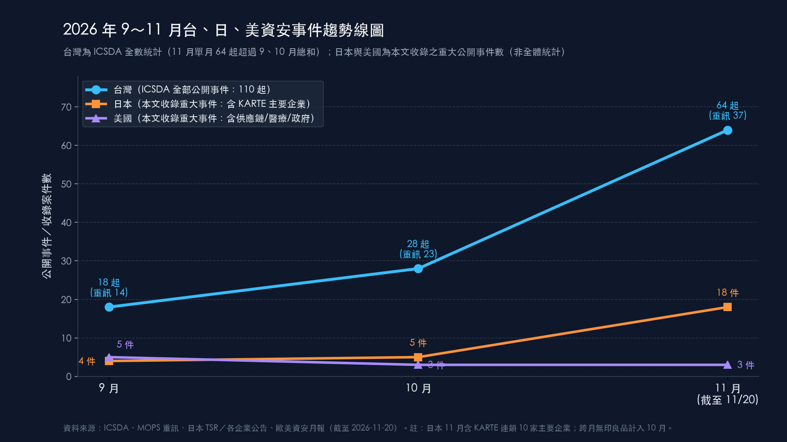

如果你這幾天有打開公開資訊觀測站（MOPS），或是盯著日本企業的資安公告，體感應該只有一個字：**炸裂**。

截至 2026 年 11 月 20 日前後，台灣 ICSDA 時間軸在 9/1～11/21 之間已經列了 **110 起**公開資安事件，其中 **74 起**附帶 MOPS 重訊；光 11 月一個月（64 起），就比 9 月（18 起）和 10 月（28 起）加起來還多。同一時間，日本在 1～10 月累計外洩已達約 3.5 億件（含可能、含重複），11 月又爆發行銷平台 KARTE 連鎖事件，累計公告直接衝破 **1 億件**、波及超過 50 家企業；美國與歐美市場同樣重災連連，從 Oracle Health 近 2,000 萬病患、國防部 DMDC 約 305 萬筆、加州教育廳 570 萬+ 學生紀錄，到 11 月 Optimizely 波及 178 個組織與 Chase／Mastercard／Uber 第三方供應鏈連環出事。

在工程現場看這些數字，最該警覺的不是「駭客變多」，而是**攻擊面已經徹底轉移**——企業花大錢守住自家機房與防火牆，最後卻因為一個共用電商 SaaS、行銷插件或委外寄信商被打穿，跟著上百個品牌一起排隊發重訊。

這篇把 2026 年 9～11 月台灣、日本與國外的重要公開案件做一次完整盤點，並從架構師與資安治理的角度，拆解三個企業團隊必須看懂的結構性訊號。

> **資料口徑說明**：本文整理截至 2026-11-20 前後的公開報導、MOPS 重訊與官方公告。件數以各單位發表為準，同一人可能在不同品牌重複受影響，**各家數字不能直接相加成人數**；駭客單方聲稱、媒體報導與官方已確認案件，在表中皆有明確區分。

---

## 一、先看三個架構級訊號：為什麼這波資安潮特別痛？

### 訊號 1：信任鏈條沒有煞車——約四成台灣事件不是自家系統被打穿

這幾年企業為了追求敏捷，大量導入各種 SaaS 服務。但一連串的供應鏈資安事件，正迫使我們面對一個殘酷的現實：**企業的「信任鏈條」已經被無限放大，卻缺乏對應的煞車機制。**

看看台、日、美三個最具代表性的案例：
* **台灣（CYBERBIZ／91APP 等電商供應鏈）**：在 9～11 月的 110 起事件中，CYBERBIZ 波及 14 起（11 月初順立智慧資料庫遭存取，至少 11 家上市櫃發重訊；且如宏碁集團 4 個線上商店在時間軸上合併為 1 起，實際受影響品牌更多）、91APP 波及 6 起（10/16 公告最多 1,329 品牌、約 480 萬人可能受影響），加上其他委外或供應商 22 起，**合計 42 起（約佔 38%）**，出事的都不是品牌自家的核心系統。
* **日本（KARTE 連鎖事故）**：行銷 SaaS 平台 **KARTE（プレイド）** 遭入侵，從 11/16 起連環引爆 DHC（約 1,911 萬）、JINS（最大約 1,829 萬帳號）、ZOZOTOWN（約 1,518 萬人）、三井住友銀行（最大約 1,400 萬）、WEAR by ZOZO（約 1,393 萬人）、しまむら（約 700 萬）、三菱日聯銀行（Mitsubishi UFJ，約 650 萬）等 50 多家大型企業，累計公告破 1 億件；郵件寄送服務 **アララ** 單一事件也波及約 7,700 萬個 Email。
* **美國（Qubole／Optimizely／Uber）**：大數據平台 **Qubole** 的跨帳號權限遭濫用，直接導致多家企業的 AWS 資料庫暴露在外；11 月則出現網站實驗 SaaS **Optimizely** 遭植入惡意 JS（波及 178 個組織網站，台灣匯豐銀行官網亦列名其中），以及 AI 平台 Fireworks AI 憑證遭竊導致 Uber 近 15 萬筆司機資料外洩。

這些受害企業的核心系統未必有漏洞，問題往往出在**兩個架構盲點**：
1. **權限與資料給得太細、太滿**：毫無保留地將原始個資、跨帳號高權限與長效金鑰交給外部平台。
2. **缺乏隔離的「直通車」**：系統間直接串接，一旦某個邊緣 SaaS 失守，攻擊者就能順著受信任的通道橫向移動，直搗企業核心。

**導入 SaaS 轉嫁了維運成本，但沒有轉嫁資料外洩的商譽與法遵責任。** 更麻煩的是「外洩後 24 小時內的精準詐騙」——台灣鳳凰旅遊、台糖健康易購網、美而快，以及香港萬寧（顧客下單不到 1 日即接獲假客服電話），都在外洩後立刻出現「真實訂單資料＋假客服／假定期購」的二次攻擊。

---

### 訊號 2：看懂 MOPS 重訊的「預防性通知人數」≠「確認外洩人數」

11 月 19 日，富邦媒（8454）針對旗下「mo店+」發布重訊，提到出貨資料遭未經授權存取，並**預防性通知約 35 萬名顧客**。很多媒體或社群看到 35 萬就直接解讀成「35 萬筆個資確定外洩」，這在工程與法遵判讀上其實差很遠。

實務上解讀重訊與企業公告，必須把三個數字分開看：

| 指標層級 | 定義 | 實務判讀重點（以 momo mo店+ 為例） |
|---|---|---|
| **1. 預防性通知範圍** | 系統紀錄中「可能被存取區間內」的潛在受影響名單 | 35 萬人是**溝通與風險控管邊界**，企業寧可放大通知範圍提醒防詐，不等於 35 萬筆全數被打包帶走 |
| **2. 實際未授權存取／外洩量** | 鑑識團隊比對 Log、流量與暗網樣本後確認的筆數 | 尚在鑑識中；重訊中同時釐清「是否涉及帳密、信用卡與付款資訊」（mo店+ 為獨立系統，主站未受影響） |
| **3. 狀態分類** | 台灣 110 起中：**已確認 34、調查中 65、未發現外洩 9、待證實 2** | 超過半數仍在調查；「待證實」多為勒索團體單方列名，需待鑑識交叉比對 |

對架構團隊來說，**能不能在 24 小時內講清楚「影響邊界」**，取決於系統有沒有做好兩件事：系統隔離（例如 mo店+ 與主站分離）以及細粒度的資料存取稽核 Log。沒有稽核軌跡，鑑識團隊就只能把整個時間窗的用戶全部算進預防性通知名單裡。

---

### 訊號 3：AI 代理已經站上攻擊端，而且專打「合法憑證」與 API

這波整理裡，有兩個非常值得 AI 工程團隊警惕的案例：
1. **台灣消防署、桃園消防局（11/16 已確認）**：攻擊者直接使用 **AI 代理**入侵救護派遣系統，將資料轉售殯葬業（目前已有 2 人羈押）。
2. **Uber 司機資料外洩案（11 月，近 15 萬筆）**：根據 SANS 報導，攻擊途徑是 AI 平台 **Fireworks AI 的憑證遭竊**——因為攻擊者拿著合法憑證登入，行為看似完全正常，**完全沒有觸發傳統告警**。

這對正在建置企業 AI Agent 與 Harness 的團隊是一個直接的警訊：
* **Agent 權限與憑證控管（Least Privilege）**：當開發者把雲端 LLM、第三方 AI 平台或內部 API Key 塞進 Agent 環境變數或設定檔（如 10 月 Zeabur 案即涉及 321 萬筆環境變數），一旦憑證外流，攻擊者就能用「合法身分」繞過 WAF 與異常登入偵測。
* **從「擋異常 IP」轉向「行為與速率異常偵測」**：當攻擊端也開始用 AI 代理自動化探索 API、模擬正常操作節奏，防禦端必須在 API Gateway 與 Agent Harness 層加上**資料存取上限、異常查詢模式（例如單一 Token 短時間遍歷大量訂單／病患紀錄）的熔斷機制**。

---

## 二、日本：9～11 月主要外洩事件

根據東京商工リサーチ（TSR）統計，2026 年 1～10 月日本企業外洩累計約 **3.5 億件**（含可能、含重複），已是前年的 10 倍以上；上市企業資安事故達 **215 件**，創 2012 年統計以來新高。11/20 更出現單日內政府（デジタル庁）與多家大企業同步公告的罕見場面。

以下彙整 **100 萬件以上，或政府、金融機構**為主的重點事件（完整每日清單可參考 [cybersecurity-info.com](https://cybersecurity-info.com/column/data-breach-list-2026/)，2026 年已收錄 615 件）：

| 日期 | 單位 | 件數 | 原因／途徑 | 備註 |
|---|---|---|---|---|
| 9/11 | デジタル庁 GSS（政府） | 約 24.6 萬（可能） | VPN 機器漏洞 | 各府省廳職員個資 |
| 9 月 | Gyazo（Helpfeel） | 約 2,362 萬 | 不正存取 | 使用者資料 |
| 9 月 | ムラウチドットコム | 約 771.7 萬 | 不正存取 | 已確認外洩 |
| 9/28 | タイムズカー（パーク24） | 約 660 萬帳號 | 不正存取 | 其中約 160 萬含證件影像 |
| 10 月 | 佐川急便 | 最大約 5,323 萬（含重複） | 包裹查詢服務遭不正存取 | TSR 列為 2026 最大 |
| 10 月 | カプコン（Capcom） | 約 1,177 萬（全球） | 不正存取 | Email 等 |
| 10 月前 | KDDI | 約 1,223 萬 | — | TSR 10 月時點列為當時最大 |
| 10 月 | ソニー生命 | 約 290 萬＋38.5 萬 | — | 含代理 Medicare 生命契約 |
| 10～11 月 | 良品計画（無印良品） | 約 2,726 萬 | 應刪未刪資料留存 | 含 109 萬筆信用卡資訊 |
| 11/2 | アララ（郵件寄送服務） | 約 7,700 萬個 Email | 不正存取 | 第 2 報精查中；波及三井住友 22.7 萬等 |
| 11/5 | アイリスプラザ | 約 770 萬人（可能） | 不正存取 | — |
| 11/5 | NTT ドコモ | 最大約 30 萬 | — | — |
| 11/11 前後 | ニトリ（宜得利） | 最多約 3,762 萬（可能） | 不正存取 | — |
| 11/16 起 | **KARTE（プレイド）連鎖** | **累計公告已破 1 億** | **行銷平台遭入侵** | **受影響 50+ 家，下表列主要者** |
| 11/17 | └ アインズ＆トルペ／アユーラ | 最大約 260 萬 | KARTE | — |
| 11/18 | └ DHC | 約 1,911 萬 | KARTE | 姓名、Email、生日 |
| 11/18～19 | └ JINS | 最大約 1,829 萬帳號 | KARTE | 不含密碼、信用卡 |
| 11 月 | └ しまむら | 約 700 萬 | KARTE | — |
| 11 月 | └ 三菱UFJ銀行 | 約 650 萬 | KARTE | 性別、年齡、居住地區 |
| 11 月 | └ RIZAP | 約 432 萬 | KARTE | — |
| 11/20 | └ ZOZOTOWN | 約 1,518 萬人 | KARTE | 含退會者 |
| 11/20 | └ WEAR by ZOZO | 約 1,393 萬人 | KARTE | — |
| 11/20 | └ 三井住友銀行 | 最大約 1,400 萬 | KARTE | 屬性資料，不含姓名帳號 |
| 11/20 | └ タイミー | 約 22.7 萬人 | KARTE | — |
| 11/20 | デジタル庁 GSS 檔案共享（政府） | 調查中 | 7/30～11/12 遭第三方存取 | 9 月案之後第二起 |
| 11/20 | Peach 樂桃航空 | 約 899.7 萬 | 郵件寄送委外商 | 非 KARTE |
| 11/20 | Payどん（鹿兒島銀行等 4 家） | 約 25.1 萬 | 委外商 Infcurion | — |
| 11/20 | シャープ通販 | 最大 326 萬（報導） | — | 尚未找到一手來源 |
| 11 月 | 楽天証券 | 未確認 | — | 金融廳下達報告命令；集團訴訟登記 1.5 萬人+ |

---

## 三、台灣：9～11 月全部公開資安事件（共 110 起）

資料來源為 [ICSDA「2026 台灣資安事件時間軸」](https://icsda.org.tw/tw-incidents-2026/)（更新至 11/20 23:20，11/20～21 事件尚未收錄）。日期為首次公開揭露日；「重訊代號」有值代表該公司於 MOPS 發布重訊；表中含少數 ICSDA 一併收錄之香港與日本事件（已於名稱標註）。「待證實」代表僅有勒索團體單方列名。

### 11 月（64 起，重訊 37 起）

| 日期 | 公司／事件 | 重訊代號 | 狀態 | 途徑 | 說明 |
|---|---|---|---|---|---|
| 11/19 | 鳳凰旅遊 | — | 已確認 | — | 訂單姓名、電話、Email、行程遭存取，出現冒名詐騙 |
| 11/19 | 台糖健康易購網 | — | 調查中 | — | 疑遭入侵，假定期購詐騙信流竄 |
| 11/19 | 富邦媒 mo店+ | 8454 | 已確認 | — | 出貨資料遭未授權存取，預防性通知 35 萬人 |
| 11/18 | 行政院（十餘家受駭企業） | — | 調查中 | — | 促企業就 800 萬筆個資外洩主動通知民眾 |
| 11/18 | DHC、JINS（日本） | — | 已確認 | KARTE | DHC 約 1,911 萬筆 |
| 11/18 | 北富銀網路銀行 | — | 調查中 | — | 1 小時 17 筆盜轉共 23 萬元 |
| 11/18 | 元太 | 8069 | 調查中 | — | 資訊系統疑遭攻擊 |
| 11/17 | 屈臣氏（香港） | — | 未發現外洩 | 第三方供應商 | 遭勒索公開系統資料，集團稱不涉個資 |
| 11/17 | 大同 e同購 | 2371 | 調查中 | — | 自動化攻擊入侵、已關站；勒索團體列名 |
| 11/17 | 永信 線上購物官網 | 1716 | 調查中 | 委外電商平台 | 部分會員資料 |
| 11/17 | 萬寧（香港） | — | 調查中 | — | 顧客下單不到 1 日即接假客服電話 |
| 11/17 | 神數 | 7821 | 調查中 | — | 部分系統遭攻擊且有未授權存取 |
| 11/17 | KKday 夥伴百科 | — | 未發現外洩 | — | 誤公開成交量、毛利率等營運數據 |
| 11/16 | 匯豐銀行台灣官網 | — | 調查中 | Optimizely | 供應鏈植入惡意 JS，波及 178 個組織 |
| 11/16 | 驊陞 | 6272 | 調查中 | — | 主機遭駭，尚未發現外洩 |
| 11/16 | 香港都會大學 | — | 調查中 | — | 約 5,000 人資料傳上暗網 |
| 11/16 | 永邑-KY | 2939 | 調查中 | CYBERBIZ | 訂單相關資料 |
| 11/16 | 消防署、桃園消防局 | — | 已確認 | — | AI 代理入侵救護派遣系統，資料轉售殯葬業；2 人羈押 |
| 11/14 | 台中多所高中校務系統 | — | 調查中 | — | 疑遭入侵 |
| 11/13 | 無印良品 | — | 已確認 | — | 逾 2,700 萬筆，含 109 萬信用卡 |
| 11/13 | TBH: 塔斯克巴·英雄（遊戲） | — | 已確認 | — | Steam ID、登入 IP |
| 11/13 | 國家資通安全研究院 | — | 調查中 | — | UNC6783 聲稱竊取 102 GB 內部文件 |
| 11/12 | 匯豐汽車 | 2215 | 調查中 | — | 部分系統遭攻擊 |
| 11/12 | 美而快 | 5321 | 調查中 | — | 會員訂單 API 遭異常存取，消費者收詐騙信 |
| 11/12 | 大聯大 | 3702 | 已確認 | — | 員工姓名、公務 Email 遭存取 |
| 11/12 | 崇光百貨（香港） | — | 已確認 | — | 約 82 萬會員資料 |
| 11/12 | 榮運 長榮物流 | 2607 | 已確認 | — | 員工個資及營業資料外洩 |
| 11/12 | 和泰車 大金空調零件商城 | 2207 | 已確認 | CYBERBIZ | 141 筆訂單、132 筆個資 |
| 11/12 | 外交部領務局 | — | 已確認 | 委外廠商設定錯誤 | 近 10 萬筆護照照片及個資 |
| 11/12 | 台積電 | 2330 | 已確認 | 雲端服務供應商 | 4.6 萬筆員工個資遭拍賣，後續再公開 260 份 HR 檔 |
| 11/11 | 奇偶 GV-VMS | — | 已確認 | — | 已知 RCE 遭利用挖礦，13 家組織 |
| 11/11 | 大葉大學校友帳號 | — | 調查中 | — | 帳號遭盜寄義大利學校炸彈恐嚇信 |
| 11/11 | 康橋 林口校區 | — | 已確認 | — | Osiris 勒索入侵，部分資料外流 |
| 11/11 | 正能量智能 | 5348 | 已確認 | WooCommerce | 子公司電商資料庫遭擷取 |
| 11/11 | 圓方科技 | 3194 | 調查中 | — | Web 系統遭攻擊 |
| 11/11 | 威力德生醫 | 7713 | 調查中 | CYBERBIZ | 訂單資料 |
| 11/10 | 漢來美食 | 1268 | 調查中 | CYBERBIZ | 訂單資料 |
| 11/10 | 沈氏 Jcolor 捷可印 | 8921 | 調查中 | 委外廠商 | 消費者遭第三方 Email 聯繫 |
| 11/10 | 黑松 | 1234 | 調查中 | CYBERBIZ | 訂單資料 |
| 11/9 | 網絡行動科技 netiCRM | — | 已確認 | — | 客戶聯絡與帳務資料遭竊，500+ 客戶主機重建 |
| 11/9 | 鼎泰豐 | — | 調查中 | — | 年菜訂購紀錄曝光，商城兩度關閉 |
| 11/9 | 力晶投控 | — | 調查中 | — | 股東個資疑外洩 |
| 11/9 | 易遊網 ezTravel | — | 已確認 | — | 逾 69 萬人歷史訂單聯絡資料 |
| 11/9 | 台灣櫻花 | 9911 | 調查中 | CYBERBIZ | 訂單及個資 |
| 11/9 | 美吾華 | 1731 | 已確認 | 委外電商平台 | 已通知受影響會員 |
| 11/9 | 曜亞 | 4138 | 調查中 | CYBERBIZ | 訂單資料 |
| 11/9 | 崇越 安永生活 | 5434 | 調查中 | CYBERBIZ | 子公司電商 |
| 11/8 | 諾貝兒 | 6844 | 調查中 | CYBERBIZ | 訂單資料 |
| 11/6 | 展碁 好漾生活 | 6776 | 調查中 | CYBERBIZ | 預防性暫停線上商店 |
| 11/6 | 宏碁集團 4 個線上商店 | 2432・7794・6857 | 調查中 | CYBERBIZ | 倚天酷碁、宏碁風尚、宏碁智新、宏碁健康 |
| 11/6 | 精材 | 3374 | 已確認 | — | 客戶、供應商、員工商務聯絡資訊 |
| 11/6 | 臺鹽 台鹽線上購 | 1737 | 調查中 | CYBERBIZ | 訂單、個資 |
| 11/6 | 天仁茗茶 熟客圈 | 1233 | 調查中 | 91APP | 範圍未釐清 |
| 11/5 | 知識科技 | 7551 | 調查中 | — | GMB 系統遭攻擊 |
| 11/5 | 騰勢 | 7889 | 調查中 | 委外服務商 | 範圍待確認 |
| 11/5 | 遠東生技 | 6886 | 調查中 | CYBERBIZ | 電子商城訂單與個資 |
| 11/4 | 王品 萬鮮 | 2727 | 調查中 | 委外購物網站 | 範圍待查 |
| 11/4 | 葡萄王 購健康 | 1707 | 調查中 | CYBERBIZ | 訂單與個資 |
| 11/4 | 永豐銀行 | — | 已確認 | 網銀供應商 | 異常轉帳；418 名存戶遭盜 4,000 萬元 |
| 11/3 | 中天生技 棉花田 | 4128 | 調查中 | 委外購物平台 | 範圍待查 |
| 11/3 | 毛寶 | 1732 | 調查中 | — | 電商網站遭攻擊 |
| 11/2 | meepShop | — | 調查中 | — | 部分商家訂單資料 |
| 11 月初 | CYBERBIZ 順立智慧 | — | 調查中 | — | 資料庫遭存取，至少 11 家上市櫃發重訊 |
| 11/2 | 任開數位 | 7904 | 已確認 | — | 自動化攻擊，部分資料遭擷取 |

### 10 月（28 起，重訊 23 起）

| 日期 | 公司／事件 | 重訊代號 | 狀態 | 途徑 | 說明 |
|---|---|---|---|---|---|
| 10/30 | 鑫傳 | 6856 | 未發現外洩 | — | 遭駭，部分檔案無法解密 |
| 10/30 | 莫筆克 Mallbic | — | 調查中 | — | ERP 主機遭執行惡意指令；SHOPLINE 換 API 金鑰 |
| 10/30 | 裕珍馨 | — | 調查中 | — | 2024–2026 訂單資料恐外洩 |
| 10/30 | 台數科 | 6464 | 未發現外洩 | — | 部分伺服器檔案遭加密 |
| 10/30 | 康那香 | 9919 | 調查中 | 91APP | 電子商城訂單 |
| 10/29 | 宏碁資訊 中選會財產申報系統 | 6811 | 已確認 | — | 誤將身分證字號載入公告檔 |
| 10/29 | 全家 行動購 | 5903 | 已確認 | 91APP | 部分會員資料遭擷取 |
| 10/28 | 橙的電子 | 4554 | 調查中 | — | NAS 遭勒索 |
| 10/28 | 1shop 一頁商店 | — | 調查中 | — | 寄信服務 API 金鑰疑外流 |
| 10/27 | 京站 Qonline | 2942 | 調查中 | 91APP | 冒名詐騙信 |
| 10/27 | 天良生技 | 4127 | 調查中 | 委外平台 | 自動化攻擊 |
| 10/27 | 高林 | 2906 | 調查中 | 91APP | 會員訂單資料 |
| 10/26 | BOOK☆WALKER 台灣漫讀 | — | 已確認 | — | 會員 Email、交易紀錄 |
| 10/23 | 柏文 健康電子商城 | 8462 | 調查中 | 91APP | 詐騙信與訂單相符 |
| 10/22 | 清淨海生技 | 7516 | 調查中 | 委外平台 | 有人聯繫消費者 |
| 10/22 | 歐都納 | 2940 | 調查中 | 委外平台 | 自動化攻擊 |
| 10/22 | 科懋生技 | 6496 | 已確認 | 委外平台 | 訂單資料遭擷取 |
| 10/21 | 立康生技 | 6242 | 調查中 | 委外平台 | 以 Email 聯繫消費者 |
| 10/21 | 美食-KY（85°C） | 2723 | 調查中 | — | 台灣子公司系統遭駭 |
| 10/19 | 滿心企業 | 2916 | 調查中 | 委外平台 | 自動化攻擊 |
| 10/19 | Zeabur | — | 已確認 | — | 321 萬筆環境變數、32 萬筆帳號紀錄；年底停止服務 |
| 10/17 | LINE Pay | 7722 | 未發現外洩 | — | 暗網兜售 75 萬筆，公司澄清非其資料 |
| 10/16 | 91APP | 6741 | 已確認 | — | 最多 1,329 品牌、約 480 萬人可能受影響 |
| 10/9 | 緯致 | 4953 | 已確認 | — | 員工資料與公務聯繫資訊 |
| 10/7 | 上福 子公司 Katun | 6128 | 未發現外洩 | — | 系統遭異常存取 |
| 10/7 | 杏一醫療用品 | 4175 | 調查中 | 委外網站平台 | 消費者反映個資外洩 |
| 10/6 | 104 人力銀行 | 3130 | 已確認 | — | 約 12 萬份履歷遭讀取 |
| 10/1 | 安心食品 摩斯漢堡 | 1259 | 調查中 | 委外平台 | 冒名聯繫消費者 |

### 9 月（18 起，重訊 14 起）

| 日期 | 公司／事件 | 重訊代號 | 狀態 | 途徑 | 說明 |
|---|---|---|---|---|---|
| 9/29 | 神腦國際 | 2450 | 已確認 | — | 自動化攻擊，訂單資訊遭擷取 |
| 9/29 | 橡木桶洋酒 | — | 待證實 | — | The Gentlemen 列名 |
| 9/29 | 鈊象 | 3293 | 已確認 | — | 玩家姓名、電話、Email 外洩 |
| 9 月下旬 | 華碩 ASUS eShop | — | 調查中 | — | 客戶聯絡資訊與訂單紀錄 |
| 9/23 | 柏文 健身工廠 | 8462 | 已確認 | 委外系統 | 員工及會員個資 |
| 9/20 | 威旭 | 7933 | 調查中 | — | 電話系統遭濫用 |
| 9/19 | 萬達寵物（第二起） | 6968 | 調查中 | — | 消費資料遭第三人利用 |
| 9/18 | 友訊 D-Link | 2332 | 調查中 | — | 撞庫攻擊 |
| 9/15 | 長榮航太 | 2645 | 未發現外洩 | — | 內部系統遭攻擊 |
| 9/15 | 長榮航空 | 2618 | 已確認 | — | 員工姓名與公務聯繫資訊 |
| 9/15 | IKEA、桂冠、六月初一、AIR SPACE | — | 調查中 | — | 假自動續訂詐騙信，源頭待查 |
| 9/14 | 崴寶 | 7744 | 未發現外洩 | — | 資料遭加密 |
| 9/14 | 東培工業 TPI | — | 待證實 | — | LockBit 5.0 列名 |
| 9/11 | 達爾膚 | 6523 | 未發現外洩 | — | 部分內部系統遭攻擊 |
| 9/9 | 大車隊 | 2640 | 已確認 | — | 11/18 重訊證實客戶、會員、外務人員資料遭擷取 |
| 9/7 | 富爾特 | 6136 | 調查中 | — | 子公司勒索，ERP 停擺 |
| 9/2 | 創新服務 | 7828 | 調查中 | — | 勒索，ERP 停擺 |
| 9/1 | 乾瞻科技 | 7898 | 調查中 | — | ERP 遭加密 |

---

## 四、國外重大資安事件（台灣、日本以外）

以規模大、或對企業供應鏈有參考價值的事件為主，並非完整清單。國外數字多來自資安媒體的月度整理，不少屬於駭客單方聲稱或媒體報導、尚未經公司證實，已在「狀態」欄明確標註。

| 日期 | 國家／單位 | 規模 | 原因／途徑 | 狀態 |
|---|---|---|---|---|
| 9 月 | 美國 FBI 求職入口網站 | 駭客稱 2～3 TB，含人員與應徵者資料 | ShinyHunters；疑 Oracle PeopleSoft 零時差 | 駭客聲稱，FBI 調查中 |
| 9 月 | IDScan.net（美國身分驗證服務） | 暗網兜售 1.53 億張駕照掃描 | 雲端平台遭未授權存取 | 公司證實遭存取；件數未證實 |
| 9 月 | RingCentral | 駭客稱 623 GB | 社交工程（ShinyHunters） | 駭客聲稱 |
| 9 月 | Condé Nast | 3,280 萬筆使用者資料遭兜售 | — | 未證實 |
| 9 月 | 德國柏林市政府 | 敏感州政府資料遭竊 | 勒索 | 已確認，拒付贖金 |
| 9 月 | 尼泊爾證券交易所 | 交易暫停 | 資料中心供應商遭勒索 | 已由備份復原 |
| 9 月 | 美國 Springfield 公立學校（麻州） | 停課數日，含學生醫療紀錄系統 | 勒索 | 已確認 |
| 10 月 | Oracle Health（Cerner） | 近 2,000 萬名美國病患 | 醫療事業單位遭入侵 | 報導；含 SSN 與醫療資料 |
| 10 月 | 丹麥 CPR 人口登記 | 約 880 萬人 | — | 報導；CPR 號碼無法輕易更換 |
| 10 月 | 美國國防部 DMDC | 約 305 萬筆 | 2025/10～2026/7 長期潛伏 | 已通知軍人與眷屬 |
| 10 月 | 美國加州教育廳 | 570 萬+ 名學生紀錄 | 帳號遭盜後複製資料 | 報導 |
| 10/29 | Binance | 約 63.6 億美元加密資產遭轉出 | — | 報導；屬資產竊取，非個資 |
| 10 月 | BytetoBreach 聲稱的病患資料 | 8,000 萬筆 | — | 駭客聲稱，未證實 |
| 11 月中 | Optimizely（網站實驗 SaaS） | 178 個組織網站遭植入惡意 JS，可竊信用卡 | 供應鏈 | 已修補；台灣匯豐官網列名 |
| 11 月 | Chase、Mastercard／Visa 的第三方供應商 | 約 1.6 萬筆 Chase、6,000+ 筆 Visa | 供應商遭駭 | Chase 稱為行銷資料；件數未證實 |
| 11 月 | Uber 司機資料 | 近 15 萬筆 | AI 平台 Fireworks AI 的憑證遭竊 | 報導（SANS）；登入看似合法，未觸發警報 |
| 11/16 | SBC Medical Group | 約 160 萬人 | — | 已公告；含密碼、病患卡號 |
| 11 月 | 倫敦交通局 TfL | 約 26.5 萬名 Oyster 卡用戶 | — | 已公告 |
| 11 月 | Maersk | 未公布 | 收購而來的舊系統遭存取 | 已公告 |

---

## 五、數位主權收復戰：建構「中繼架構（資料守門員）」與 SaaS 大洗牌

這波危機不會讓企業全面放棄 SaaS，但正在加速一場**「數位主權收復戰」**。與其盲目依賴外部平台的合規認證，越來越多企業開始在核心與邊緣之間，建構自己的**「中繼架構（資料守門員）」**，把控制權牢牢抓回手裡：

1. **資料降權（Data De-privileging）**：不把原始個資直接餵給外部平台，而是透過中繼層清洗、去識別化或雜湊（Tokenization），確保外流的只是無害碎片——特別是「訂單明細＋手機／Email」這類假客服詐騙的起手式組合，必須嚴格盤點欄位邊界。
2. **切斷直通車（系統隔離）**：所有進出外部服務的流量，統一收斂至 API Gateway 控管與過濾，阻斷橫向擴散的可能；像 momo `mo店+` 與主站分離的設計，就是把事故爆炸半徑鎖在單一子系統的標準示範。
3. **動態秘密管理（Dynamic Secret Management）**：告別硬編碼與長效 Token。應用程式與 AI Agent 不再直接持有外部金鑰，而是向中央閘道請求短期動態憑證；即便外洩，也能一鍵撤銷與輪替，並加上異常查詢速率熔斷，避免重演「合法憑證直接搬空資料卻零警報」的狀況。
4. **預演「外洩後 24 小時」的稽核與通知機制**：確保存取 Log 足以在一天內劃出「預防性通知範圍」，並同步啟動防詐騙公告，搶在假客服電話之前觸及用戶。

這對整個 SaaS 產業來說，將會是一場劇烈的大洗牌。當企業開始把「資安治理」與「架構隔離」拉高到戰略層級，那些缺乏核心價值、又無法配合企業安全標準的邊緣 SaaS，將會腹背受敵，很快就會被市場淘汰。

**未來能留下來的，不只是功能好用的工具，而是真正懂得尊重企業「數位主權」的夥伴。**

---

## 參考資料與公開來源

* 台灣事件：[ICSDA 2026 台灣資安事件時間軸](https://icsda.org.tw/tw-incidents-2026/)、[momo mo店+（數位時代）](https://www.bnext.com.tw/article/93121/momo-mo-store-plus-cybersecurity-incident)、[iThome 資安週報 1102～1106](https://www.ithome.com.tw/news/180291)、[1109～1113](https://www.ithome.com.tw/news/180500)、[1116～1120](https://www.ithome.com.tw/news/180681)、[民視：上市櫃資安事件增近 6 成](https://www.ftvnews.com.tw/news/detail/2026B11W0496)
* 日本事件：[TSR：上市企業個資外洩過去最悪ペース](https://www.tsr-net.co.jp/data/detail/1203305_1527.html)、[Web担：2026 最大為佐川急便約 5,323 萬件](https://webtan.impress.co.jp/n/2026/11/17/53592)、[2026 年國內個資外洩事案一覽](https://cybersecurity-info.com/column/data-breach-list-2026/)、[マイナビ 9 月整理](https://news.mynavi.jp/techplus/article/20260930-5050581/)、[innovatopia 9 月](https://innovatopia.jp/cyber-security/cyber-security-news/119067/)、[innovatopia 11 月](https://innovatopia.jp/cyber-security/cyber-security-news/119744/)、[piyolog：KARTE 整理](https://piyolog.hatenadiary.jp/entry/2026/11/18/010752)、[Impress Watch：KARTE 影響企業](https://internet.watch.impress.co.jp/docs/news/2157316.html)、[三井住友 1,400 萬](https://news.livedoor.com/topics/detail/32864098/)、[ZOZOTOWN 官方公告](https://zozo.jp/news/article/499/)、[Peach 899 萬](https://www.chunichi.co.jp/article/1342394)、[デジタル庁 GSS 11/20](https://www.itmedia.co.jp/business/articles/2611/20/news065.html)、[宜得利 3,762 萬](https://finance.technews.tw/2026/11/11/nitori-cyber-attack)、[無印良品逾 2 千萬筆](https://news.pts.org.tw/article/835509)
* 國外事件：[CM-Alliance 9 月](https://www.cm-alliance.com/cybersecurity-blog/major-cyber-attacks-data-breaches-ransomware-attacks-september-2026)、[SOCRadar 9 月](https://socradar.io/blog/major-cyber-attacks-september-2026/)、[CM-Alliance 10 月](https://www.cm-alliance.com/cybersecurity-blog/biggest-cyber-attacks-data-breaches-ransomware-attacks-october-2026)、[Quartz 10 月](https://qz.com/biggest-data-breaches-2026)、[Loginsoft 10 月](https://www.loginsoft.com/post/october-2026-cyberattacks-major-breaches-threats)、[Tech.co](https://tech.co/news/data-breaches-updated-list)、[Privacy Guides 11/13～19](https://www.privacyguides.org/news/2026/11/20/data-breach-roundup-nov-13-19-2026/)、[BTI 11/20](https://www.btigroup.com/post/ai-cybersecurity-update-november-20-2026/)、[SharkStriker 11 月](https://sharkstriker.com/blog/data-breaches-in-november-2026/)
