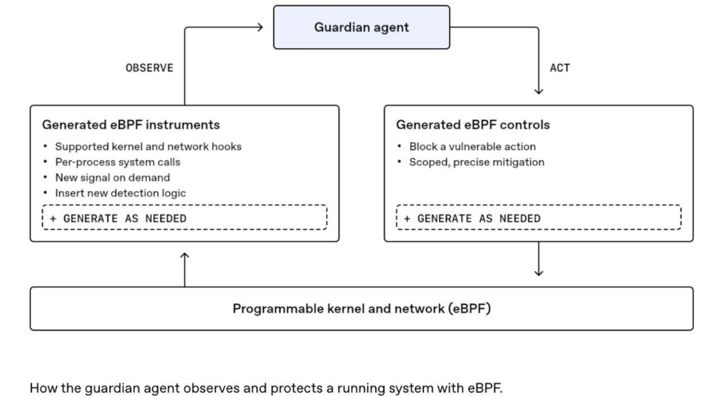

OpenAI 最近丟出兩顆震撼企業資安圈的重磅消息。

第一顆是資安研究報告〈*A thousand fewer paths to root*〉：旗下資安模型 **GPT-6 Cyber** 掃描 Linux 核心主線，一口氣動態重現 1,724 個缺陷，並自主寫出 **948 個能拿到 `root` 最高權限的本地提權漏洞（LPE）**，整趟 API 成本僅約 121 萬美元（平均每個漏洞約 1,280～1,359 美元）。

第二顆緊接在後：OpenAI 聯手思科（Cisco，由旗下 **Isovalent** 團隊共同打造）開源了 **Shirudo**（日文「盾」之意，`github.com/shirudo-dev/shirudo`），提出一套全新的防禦架構——**`AI → eBPF`**：不用重啟伺服器、也不改應用程式原始碼，直接讓 AI 往運行中的 Linux 系統裡貼上一層精準的臨時「防護盾」。

這套新架構瞄準的是企業最痛的**「補丁空窗期（Patch Gap）」**：AI 找漏洞已經按幾百個算，但企業打正式補丁得等上游發版、排期測試再重啟，一拖就是幾週；中間若粗暴封死介面，正常業務又會癱瘓。

從官方架構圖可以看到，Shirudo 由 **Guardian Agent** 驅動一個建立在 eBPF 之上的 **Observe & Act（觀測—行動）** 閉環：
* 遇到新漏洞時，由 **Codex** 自動生成鎖定該漏洞路徑的輕量級防護盾（`upatch`），先拿模擬攻擊與正常流量跑過驗證，再打包成 **`.bee`（Beefile）** 透過標準 **OCI Registry** 分發。
* 在 OpenAI 與思科公開的受控實驗室示範中，Codex 寫的防護盾直接掛進運行中的 **Elasticsearch**，在 Java 的 **Base64 解碼路徑**加上輸入驗證，成功當場攔下 **Java4Shell** 攻擊且服務零停機（*註：此為官方受控示範，非本文作者生產環境實測*）。
* 為了防止 AI 寫崩核心或被駭客塞假盾／拿到 `root` 後偷拆盾，Shirudo 卡了三道硬門檻：**人類審核與密碼學簽章**、**Linux 核心內建 eBPF 安全驗證器（Verifier）**，以及強制透過主機 **TPM 2.0 硬體安全晶片**記錄每一次載入與卸載狀態並產出防竄改證明（Attestation）。

聽起來很迷人，對吧？但回到企業現場，架構師必須立刻追問四個最現實的問題：**`AI → eBPF` 是資安萬靈丹嗎？能擋掉大部分 CVE 嗎？開自動阻斷會不會先把自家 App 打掛？未來完整的防禦層級到底長什麼樣？**

這篇文章一次幫你拆乾淨。

---

## 一、它不是萬靈丹：先搞懂 eBPF，以及 K8s 已經跑在線上的實作

很多討論會把 **eBPF、Cilium、Tetragon、Shirudo** 混在一起講，先用一句話把層級切開：

> **eBPF 是 Linux 核心內建的「底層引擎」**（網路層與 OS 層它都能掛）；**Cilium 開網路戰車，Tetragon／Shirudo 開 OS 裝甲車。**

用 eBPF 做「不重啟伺服器、核心層即時監控與攔截」，其實並不是 Shirudo 才發明的，**在 Kubernetes 生產環境早就非常成熟**：

* **雲端大廠已經原生整合**：Google Cloud（**GKE Dataplane V2**）、AWS EKS、Azure AKS、Alibaba Cloud 的託管 Kubernetes，底層都已原生整合 **Cilium／eBPF** 工具鏈。
* **大型企業早已大規模商用**：**Adobe、Bloomberg、ByteDance、Confluent、Asana、ClickHouse** 等企業，已在數千節點規模的生產環境採用 Cilium／Tetragon 做核心級零信任與執行期防護。

把現有主流 eBPF 工具跟 Shirudo 擺在一起對照，就能看懂差別：

| 專案／廠商 | 守哪一層？ | 規則怎麼來？ |
|---|---|---|
| **Cisco / Isovalent（Cilium）** | **網路層（CNI）**：取代傳統 `iptables`，管 Pod 身分與 L3/L4/L7（HTTP/gRPC/DNS）流量過濾 | 人類寫 `CiliumNetworkPolicy`（YAML） |
| **Cisco / Isovalent（Tetragon）** | **OS／行程層**：核心內同步攔截系統呼叫、檔案存取與異常行程 | 人類寫靜態 `TracingPolicy`（YAML） |
| **Wiz（Defend）／Datadog（CWS）／CrowdStrike（Falcon）／Sysdig（Falco）** | **OS／容器執行期**：用 eBPF Probe 擷取海量 syscall 做即時威脅偵測與防護 | 廠商規則引擎或自訂行為規則，以告警與行程層阻斷為主 |
| **OpenAI × Cisco（Shirudo）** | **OS／行程＋應用執行路徑（Agent-Native）** | **AI（Codex）針對新 CVE 動態寫精準微補丁**＋簽章＋TPM 2.0 記帳 |

### 先別急著把 Shirudo 裝上生產機——但你在 GKE 今天就能先做八成
翻完 `shirudo-dev/shirudo` 文件會發現，Shirudo 目前還是**早期預覽版**：它強制要求帶專用 `signed-loader` 補丁的 **`bpf-next` 開發版核心**（無降級相容模式）、強制 **TPM 2.0 ＋ `systemd >= 256` ＋ UKI 啟動鏈**，而且**目前無法與 Cilium、Tetragon、Falco 共存於同一台受保護主機**。一般公有雲 VM（包含 GKE 鎖定核心的 COS 節點）根本跑不起來，現階段只適合在本機虛擬機搭 `swtpm` 試玩。

不過這不代表企業只能乾等。如果你用的是 **GKE Standard（或 EKS／AKS 標準節點）**：
* **今天就能落地路線 A**：直接建一條 **`CVE → AI 生成 CiliumNetworkPolicy / Tetragon TracingPolicy（YAML）→ Staging 測試 → PR 簽核 → kubectl apply`** 的 GitOps 管線，不用改節點核心，就能跑出「不重啟熱套用防護」的八成威力。
* **想走更細的裸 eBPF C（路線 B）**：技術上在 GKE Standard 可行（Autopilot 會鎖死 `CAP_BPF`），但節點 OS 建議選 **`UBUNTU_CONTAINERD`** 而非預設 COS，且少掉 Shirudo 的核心強制驗簽與 TPM 記帳，風險需自負。
* **想跑 Shirudo 完整版（路線 C）**：必須等補丁進 Linux 主線核心，並由 GCP／AWS／Azure 原生整合進節點 OS。

---

## 二、能擋掉大部分的 CVE 嗎？不行——看清 eBPF 的能力邊界

就算把 `AI → eBPF` 做到極致，它**也絕對擋不了所有 CVE**。企業架構師必須把它的「主場」跟「盲區」畫清楚：

### 1. eBPF 非常擅長擋的 CVE（高危系統與網路類）
* **Linux 核心本地提權（LPE）**：像 GPT-6 Cyber 掃出的 948 個核心洞、`io_uring`／`netfilter` 提權，可直接在核心層封鎖特定高危 syscall 或異常參數組合。
* **遠端程式碼執行（RCE）／命令注入**：如 Log4Shell、Java4Shell、Spring4Shell。Tetragon 可直接禁止 Web／Java 行程呼叫 `execve("/bin/sh")` 或 `curl`；Cilium 可鎖死異常外連（LDAP／C2）；Shirudo 甚至可插進特定解碼函式擋惡意輸入。
* **路徑穿越／敏感檔案外洩**：盯住 `openat` 系統呼叫，限制服務只能讀白名單目錄，偷讀 `/etc/passwd`、K8s Token 或 `.env` 當場攔截。
* **SSRF／內網橫向移動**：Cilium 直接封死 Pod 打向雲端 Metadata (`169.254.169.254`) 或內部管理埠的流量。

### 2. eBPF 幾乎擋不住的 CVE（盲區）
* **商業邏輯與權限越權（IDOR／BOLA／驗證繞過）**：例如 A 用戶改個訂單編號參數就撈出 B 用戶的資料。對 Linux 核心來說，這就是一次完全正常的 HTTP 請求＋正常的資料庫查詢，**核心根本看不懂商業邏輯**。
* **資料外洩型 SQL Injection**：只要攻擊者沒執行 OS 命令、只是透過合法 DB 連線把整張表倒出來，核心層很難單靠 syscall 區分好壞。
* **前端與瀏覽器漏洞（XSS、CSRF、瀏覽器零日）**：發生在使用者瀏覽器，不在你的 Linux 伺服器裡。
* **合法憑證外洩濫用**：像上週我們在〈[2026 年 9～11 月台日與全球資安總整理](/cybersecurity-2026-q4-saas-supply-chain-ai-agent/)〉提到的 Uber 司機資料外洩案（Fireworks AI 憑證遭竊）——攻擊者拿真鑰匙開門，行為在 OS 層看起來完全合法。

---

## 三、如果對它擅長的部分開「自動阻斷」，App 會有問題嗎？會，所以還是要驗證！

再問一個更痛的現場問題：既然 eBPF 很擅長擋 RCE、提權跟異常外連，那我們能不能直接開「全自動阻斷（Auto-Enforce）」？

**答案是：直接開一定會把正常 App 打掛。** 實務上最常見四種誤殺（False Positive）地雷：

1. **App 或套件偷偷呼叫了「你以為它不會做的事」**：鎖死 Java／Python 不准開子行程，結果隔天轉 PDF 功能叫了 `wkhtmltopdf`／`ffmpeg`，或是 K8s **Liveness Probe** 在容器裡跑 `/bin/sh -c curl ...`，一開自動阻斷，Pod 立刻被殺成 **`CrashLoopBackOff`**。
2. **封錯 syscall 拖垮效能**：為了防提權封掉 `io_uring`，結果 Nginx、Netty 或資料庫驅動剛好靠它做非同步 I/O，App 直接報錯或延遲雪崩。
3. **粗暴 `Sigkill` 反成 DoS 武器**：如果規則一觸發就砍掉整個共用 worker 行程，攻擊者只要狂送惡意請求，就能借你的防護盾把你的伺服器一直打重啟（實務上應優先攔截單次呼叫／Drop 連線，而非直接殺行程）。
4. **Cilium 網路政策漏放隱性相依**：鎖了 egress 卻漏開 CoreDNS（53 埠）、憑證更新（OCSP／JWKS）或第三方金流回呼，平常沒事，一到換證或結帳就整批失敗。

### 所以「還是要驗證」——那跟直接驗證正式補丁到底差在哪？
**沒錯，驗證絕對省不掉！** 標準上線流程一定是：**先 Audit（只告警不阻斷）→ 隔離環境跑「模擬攻擊＋正常業務 E2E 回歸」雙向測試 → Canary 灰度單一 Pod → 異常自動秒退**。

既然都要驗證，臨時防護盾真正替企業買到的不是「免驗證」，而是三個關鍵差距：
* **不用等上游發版**：正式補丁得先等開源社群或軟體商修完發新版，光等就先耗掉幾天到幾週；AI 防護盾在 CVE 曝光當下幾分鐘就能產出來進測試。
* **影響範圍（Blast Radius）差十倍**：升級整個 Linux 核心或 Java／Elasticsearch 大版本，往往會順帶帶進一堆無關改動與相依衝突，必須跑全系統回歸並排停機重啟；臨時防護盾只鎖定「那一個漏洞路徑」，**不用改 App 映像檔、不用重啟服務**。
* **回滾成本完全不同**：正式升級出事常要重開機甚至卡資料相容性；eBPF 防護盾或 YAML 政策出事是**秒級熱卸載**，幾乎零停機成本。

---

## 四、未來的企業防範層級：三層縱深防禦，以及 AI 各自能幫上什麼忙？

看清了 eBPF 的能力邊界與驗證成本，我們就能畫出 AI 時代企業真正可落地的**三層防禦架構**——沒有任何單一層是萬靈丹，但每一層都能把 AI 嵌進「防禦 Harness」裡放大效率：

| 防禦層級 | 專門守什麼？ | 核心工具與機制 | AI 可以幫助的部分（防禦 Harness） |
|---|---|---|---|
| **1. 核心與執行期層（Kernel & Runtime）** | Linux 核心提權（LPE）、RCE／命令注入、異常行程、敏感檔存取、SSRF 與東西向橫向移動 | eBPF、Cilium（網路層）、Tetragon（OS 層）、未來的 Shirudo（Agent-Native＋TPM 2.0） | 讀取 CVE 自動生成 Cilium／Tetragon 政策 YAML 或 eBPF 防護盾；在 Staging 自動跑「模擬攻擊＋E2E 回歸」雙向驗證；異常 syscall 摘要與秒級回滾建議。 |
| **2. 應用與邏輯層（Application & Logic）** | IDOR／BOLA 權限越權、商業邏輯漏洞、資料外洩型 SQLi、API 濫用、前端 XSS／CSRF | WAF、API Gateway、程式碼權限設計、SAST／DAST、自動化測試 | 在 CI/CD 與 PR 階段做商業邏輯與授權邊界審查（找出 eBPF 看不懂的越權洞）；自動生成 WAF／API Gateway 臨時過濾規則、正式程式碼 Patch 與單元測試。 |
| **3. 身分與憑證層（Identity & Credential）** | API Key 外洩、長效 Token 濫用、AI Agent 過度授權、合法帳號異常遍歷資料 | 最小權限 IAM、短效憑證／Workload Identity、Secret 治理、API 行為速率熔斷 | 自動盤點過度授權的 IAM 與 Agent 權限；建立「合法身分」的正常行為基線，當單一 Token 短時間異常遍歷大量訂單或個資時，在 Gateway／Harness 層即時觸發熔斷與憑證撤銷。 |

把這三層疊加「雙速防禦（Two-Speed Defense）」的節奏，就是未來企業資安的新常態：

* **高速止血層（分鐘～小時級）**：新漏洞或異常行為出現時，由 AI 依所在層級產出精準的臨時防線（eBPF 防護盾、Cilium／Tetragon 規則、WAF 規則或憑證熔斷），跑完自動化雙向驗證後由人類簽核熱套用，替企業爭取數天到數週的緩衝視窗。
* **穩態修補層（天～週級）**：待上游釋出正式補丁或完成程式碼重構後，走回企業標準 CI/CD 與完整回歸測試，排程部署上線，最後安全卸載臨時防護盾。

OpenAI 與思科開源的 Shirudo，並不是要讓企業從此不用打補丁，也不是能包治百病的萬靈丹；它真正標誌的轉折點是——**防禦端終於開始用 AI 的速度，把「核心與執行期層」的零停機止血工程化了**。至於能不能真正守住企業系統，還是取決於你把「驗證流程」跟「三層防線」搭得有多紮實。

---

### 參考與查核來源
* OpenAI 資安研究報告：*A thousand fewer paths to root*（GPT-6 Cyber 掃描 Linux 核心驗出 948 個 LPE 提權漏洞之數據）
* OpenAI 與 Cisco（Isovalent）Shirudo 官方發布說明、架構圖與開源文件：`github.com/shirudo-dev/shirudo`、`shirudo.dev`（Guardian Agent、`.bee`／OCI 分發、Java4Shell × Elasticsearch 受控示範、`bpf-next` 客製核心、TPM 2.0 與 eBPF 工具排他性限制）
* 雲原生 eBPF 生態與企業採用公開資料：Cilium / Tetragon（CNCF／Isovalent）、GKE Dataplane V2、Wiz Defend、Datadog CWS、CrowdStrike Falcon Cloud Security、Sysdig / Falco
